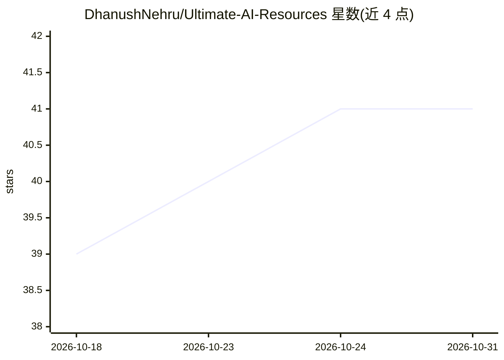

# DhanushNehru/Ultimate-AI-Resources

⭐ 41 · JavaScript · MIT · 推送 2026-10-25 · [GitHub](https://github.com/DhanushNehru/Ultimate-AI-Resources) · [官网](https://dhanushnehru.github.io/Ultimate-AI-Resources) · 个人维护

**500+ 条 AI 工具与学习资源策展清单（awesome list）**

由 Dhanush Nehru 个人维护的 AI 资源聚合清单：收录 500+ 链接，按学习课程、框架库、MLOps、数据集、AI 工具应用、伦理治理、社区等板块组织，另含快速上手代码示例（LangChain 聊天机器人、Hugging Face 图像分类、RAG）、30 天学习挑战、10-15 个月学习路线图、LLM 与向量数据库对比表及面试题。清单自动同步至配套 Web 门户，通过 PR 贡献。本身无可安装产物。

## 筛选速览

| 维度 | 判定 | 备注 |
|---|---|---|
| AI 角色 | `ai-knowledge` | 知识聚合/清单类 |
| 许可风险 | `permissive` | MIT |
| 部署形态 | `library` | 以包/库形式分发 |
| 模型依赖 | — | README 未给出锁定关系 |
| 硬件要求 | — | 无带数字的原话,不猜 |
| 安装摩擦 | `low` | 无编译、无系统依赖或容器化 |
| 成熟度 | — | 结构信号不足 |

## 能力要点

- 500+ 条 AI 工具、框架、数据集、论文与课程链接
- 分类覆盖学习、框架、MLOps、数据集、工具应用、伦理与社区
- 附 30 天学习挑战与 10-15 个月零基础路线图
- 含 LLM 提供商与向量数据库对比表及入门代码示例

## 适用场景

- 系统性地查找 AI 各领域工具与学习资料
- 按路线图从零基础学习到能落地 ML 工程
- 准备 AI 技术与系统设计面试
- 了解 2025-2026 趋势 AI 工具

## 场景标签

`精选清单` `教程课程` · 领域:学习与行业

## 证据(README 行号)

> L3: A curated list of Artificial Intelligence Tools, Resources, References etc. for all of your needs
> L5: > **The ultimate curated collection of AI tools, frameworks, datasets, papers, courses and communities** — everythin
> L405: > This repository is automatically synced with our Interactive Web Portal. Any changes merged into the `main` bran

## 星数曲线

2026-10-18 39 → 2026-10-31 41（+2）

---
*卡片 v1 · prompt 1.4 · 生成 2026-10-25 · 置信度 mid · 依据 README sha `897033864fa7` · [字段定义](../../DATASET.md)*
