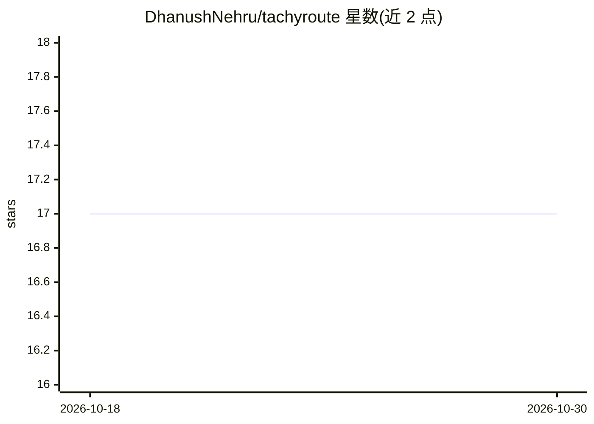

# DhanushNehru/tachyroute

⭐ 17 · Python · Apache-2.0 · 推送 2026-10-28 · [GitHub](https://github.com/DhanushNehru/tachyroute) · [官网](https://huggingface.co/dhanushnehru/tachyroute-base) · 个人维护

**亚15ms可解释零样本分类决策引擎：早退计算+注意力溯源**

基于非自回归 Transformer 的零样本决策引擎：对文本、代码或结构化 JSON 状态输出 choice/score/boolean 三类决策，声称 P99 延迟约 15ms（T4 GPU 实测 15.2ms）。机制包括：自适应早退（置信度达标即提前退出前向计算）、基于注意力 Rollout 的证据抽取（返回触发决策的文本片段）、以及轻量量化模型与多语言专家模型间的动态路由（支持100+语言）。README 给出 MASSIVE/XNLI 基准数值与 pip 安装方式，另提供 HTTP API 服务安装选项与 Hugging Face 模型/Space。

## 筛选速览

| 维度 | 判定 | 备注 |
|---|---|---|
| AI 角色 | `ai-native` | 本体是模型或模型工具 |
| 许可风险 | `permissive` | Apache-2.0 |
| 部署形态 | `library` | 以包/库形式分发 |
| 模型依赖 | — | README 未给出锁定关系 |
| 硬件要求 | — | 无带数字的原话,不猜 |
| 安装摩擦 | `medium` | 含编译或系统依赖之一 |
| 成熟度 | — | 结构信号不足 |

## 能力要点

- 自适应早退计算，声称 P99 延迟约 15ms（T4 上 15.2ms）
- 注意力 Rollout 证据抽取，返回触发决策的文本片段
- choice/score/boolean 三类决策，处理文本/代码/结构化 JSON 输入
- 轻量模型与多语言专家模型（100+语言）动态路由

## 适用场景

- 对文本/代码/JSON 做毫秒级零样本意图或自然语言推理分类
- 需要附带证据片段的可解释决策（如审核、路由分发）
- 在延迟敏感的在线服务中替代生成式模型做结构化判断

## 场景标签

 · 领域:机器学习/文本分类

## 证据(README 行号)

> L21: It evaluates typed decisions (`choice`, `score`, `boolean`) over any state (text, code, or structured JSON) in unde
> L27: 1. **Adaptive Early-Exit Computing:** Why run a 24-layer transformer for a simple question? TachyRoute actively mon

## 星数曲线

2026-10-18 17 → 2026-10-30 17（+0）

---
*卡片 v1 · prompt 1.4 · 生成 2026-10-30 · 置信度 high · 依据 README sha `58e7a813afbe` · [字段定义](../../DATASET.md)*
