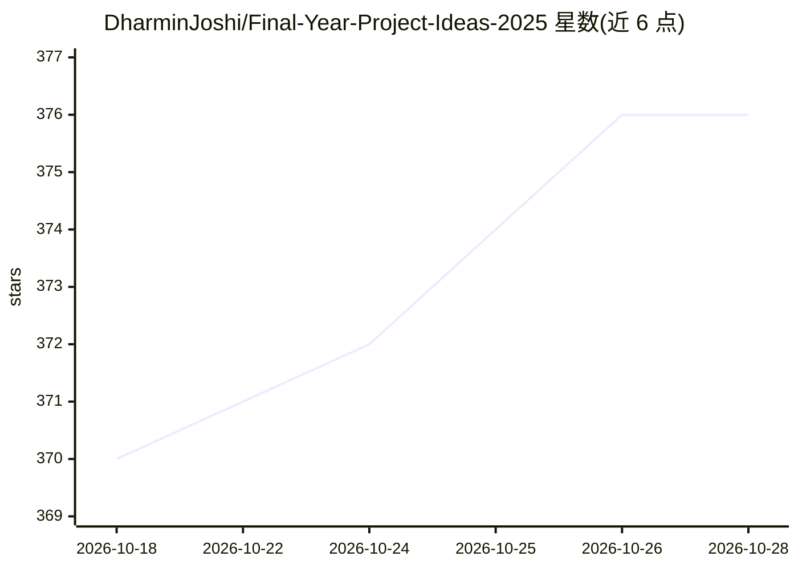

# DharminJoshi/Final-Year-Project-Ideas-2025

⭐ 377 · NOASSERTION · 推送 2026-01-17 · [GitHub](https://github.com/DharminJoshi/Final-Year-Project-Ideas-2025) · 个人维护

**面向毕业生的 100 个毕业设计项目创意清单**

策展型清单仓库：收录 100 个毕业设计项目创意，按编号列表呈现标题、一句话描述与难度标签（Beginner/Intermediate/Advanced），覆盖 AI、社区服务、可持续、健康、教育等领域，其中多个条目涉及 AI/NLP/OCR 技术应用（如简历筛选、情绪分析聊天机器人）。README 仅提供浏览指引，无代码、无安装运行流程。

## 筛选速览

| 维度 | 判定 | 备注 |
|---|---|---|
| AI 角色 | `ai-knowledge` | 知识聚合/清单类 |
| 许可风险 | `none` | NOASSERTION |
| 部署形态 | `None` |  |
| 模型依赖 | — | README 未给出锁定关系 |
| 硬件要求 | — | 无带数字的原话,不猜 |
| 安装摩擦 | `low` | 无编译、无系统依赖或容器化 |
| 成熟度 | — | 结构信号不足 |

## 能力要点

- 100 个项目创意条目
- 每条含标题、描述与三级难度标注
- 覆盖 AI、可持续、健康、教育等多领域

## 适用场景

- 毕业设计选题时浏览灵感
- 按难度等级挑选适合自己水平的项目

## 场景标签

`精选清单` · 领域:学习与行业

## 证据(README 行号)

> L5: This repository contains 100 innovative and impactful project ideas, perfect for final year students looking for ins
> L13: |1|Personalized Habit Tracker with AI Insights|Track habits and get AI-based suggestions to improve productivity an

## 星数曲线

2026-10-18 370 → 2026-10-28 376（+6）

---
*卡片 v1 · prompt 1.4 · 生成 2026-10-21 · 置信度 high · 依据 README sha `4fdc55aa87cd` · [字段定义](../../DATASET.md)*
