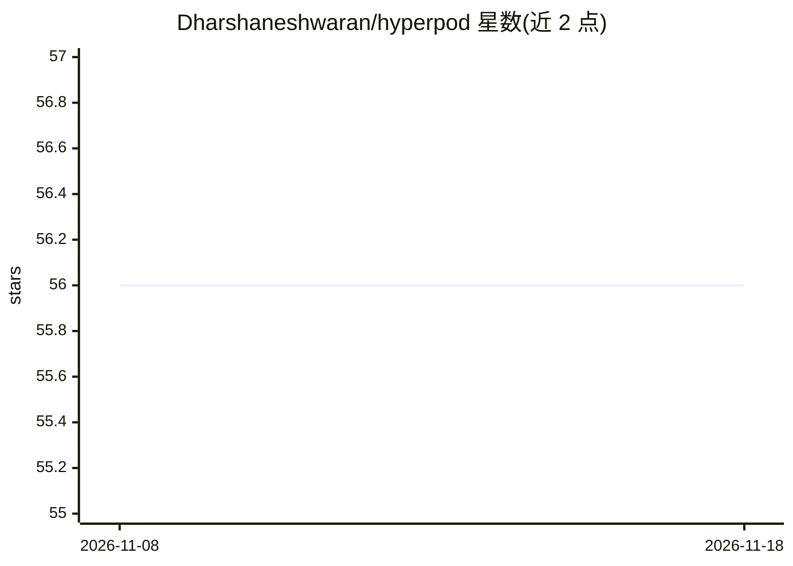

# Dharshaneshwaran/hyperpod

⭐ 56 · Go · Apache-2.0 · 推送 2026-11-01 · [GitHub](https://github.com/Dharshaneshwaran/hyperpod) · 个人维护

**将多台消费级笔记本组成本地集群，分布式运行 Meta Llama 模型**

本地推理控制平面：通过 UDP 广播发现同一可信局域网内的 worker，采集各机器空闲 VRAM 与遥测数据，按测量值减去 512 MiB 保留量计算确定性张量权重，经 llama.cpp RPC 把 Llama 模型切分到 CUDA 与 Metal 设备上；worker 掉线后重启新拓扑并对同一请求重试。控制器为 Go，worker 为 Rust，附 React 面板展示拓扑、遥测与实际权重分布。自述为黑客松原型：仅限可信内网、无认证加密，分布式模式因 Wi-Fi 明显慢于单机，聚合的是显存容量而非算力。

## 筛选速览

| 维度 | 判定 | 备注 |
|---|---|---|
| AI 角色 | `ai-ecosystem` | LLM/agent 周边工具 |
| 许可风险 | `permissive` | Apache-2.0 |
| 部署形态 | `desktop` | 安装包/桌面程序 |
| 模型依赖 | local-ok | 支持本地模型 |
| 硬件要求 | — | 无带数字的原话,不猜 |
| 安装摩擦 | `medium` | 含编译或系统依赖之一 |
| 成熟度 | `idea` | |

## 能力要点

- UDP 广播发现 + HTTP 心跳注册 worker 并刷新遥测
- 按实测空闲 VRAM 计算确定性分层权重并经 llama.cpp RPC 切分模型
- worker 掉线后约 3 秒重建拓扑并对同一请求重试（不保留已生成 token/KV cache）
- React 面板展示拓扑、遥测与模型权重实际落位

## 适用场景

- 单卡显存不足时，把多台笔记本显存合并运行 8B 模型
- 在不可靠的家用设备上观测模型部署位置并在掉线后自动恢复
- 查看集群各节点 GPU/温度/内存等实时遥测

## 场景标签

`推理引擎` · 领域:训练与推理

## 证据(README 行号)

> L5: HyperPod is a local inference controller that discovers consumer laptops on the
> L136: The controller does not implement transformer kernels. llama.cpp performs the

## 星数曲线

2026-11-08 56 → 2026-11-18 56（+0）

---
*卡片 v1 · prompt 1.4 · 生成 2026-11-18 · 置信度 high · 依据 README sha `bbac55a155c8` · [字段定义](../../DATASET.md)*
