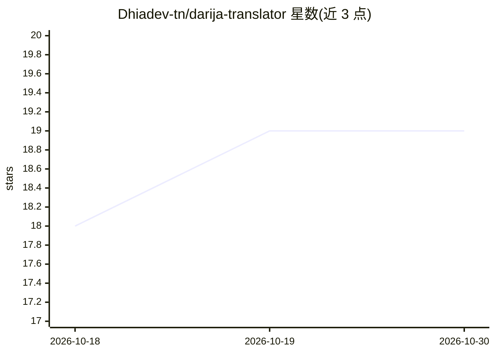

# Dhiadev-tn/darija-translator

⭐ 19 · Python · NOASSERTION · 推送 2026-07-26 · [GitHub](https://github.com/Dhiadev-tn/darija-translator) · 个人维护

**从零构建的突尼斯方言-英语翻译模型与数据集**

个人从零实现的突尼斯 Darija 到英语的神经机器翻译流水线：自研 SentencePiece BPE 分词器（Arabizi 感知，1.6 万词表），约 15.6M 参数的 Encoder-Decoder Transformer，先在 3.6 万条清洗后的摩洛哥 Darija 平行语料上预训练，再用 553 条手工编写与实地采集（含来源标注）的突尼斯语料微调，v1 基线 BLEU 3.89。数据集分 53 个类别持续扩充。面向低资源方言 NLP 研究者与开发者，训练与推理通过 Python 脚本运行。

## 筛选速览

| 维度 | 判定 | 备注 |
|---|---|---|
| AI 角色 | `ai-native` | 本体是模型或模型工具 |
| 许可风险 | `none` | NOASSERTION |
| 部署形态 | `library` | 以包/库形式分发 |
| 模型依赖 | — | README 未给出锁定关系 |
| 硬件要求 | `gpu-8g` | |
| 安装摩擦 | `medium` | 含编译或系统依赖之一 |
| 成熟度 | `idea` | |

## 能力要点

- 从零实现的 Encoder-Decoder Transformer（~15.6M 参数，权重绑定输出层）
- Arabizi 感知的 SentencePiece BPE 分词器（3/7/9/5 受保护标记）
- 553 条来源标注的手工/实地采集突尼斯平行语料，53 个类别，零合成数据
- v1 基线 BLEU 3.89，50 条锁定测试集评估

## 适用场景

- 研究低资源方言的机器翻译基线
- 获取带来源标注的突尼斯 Darija-英语平行数据
- 复现从分词到训练评估的完整 NLP 流水线

## 场景标签

`模型训练` `微调` · 领域:训练与推理

## 证据(README 行号)

> L2: ### A From-Scratch Tunisian Darija–English NLP Pipeline & Field-Collected Dataset
> L127: |Architecture|Encoder-Decoder Transformer|
> L151: The model demonstrates partial understanding of Darija structure. Simple sentences translate with recognizable mea

## 星数曲线

2026-10-18 18 → 2026-10-30 19（+1）

---
*卡片 v1 · prompt 1.4 · 生成 2026-10-29 · 置信度 high · 依据 README sha `c6ed691b91fb` · [字段定义](../../DATASET.md)*
