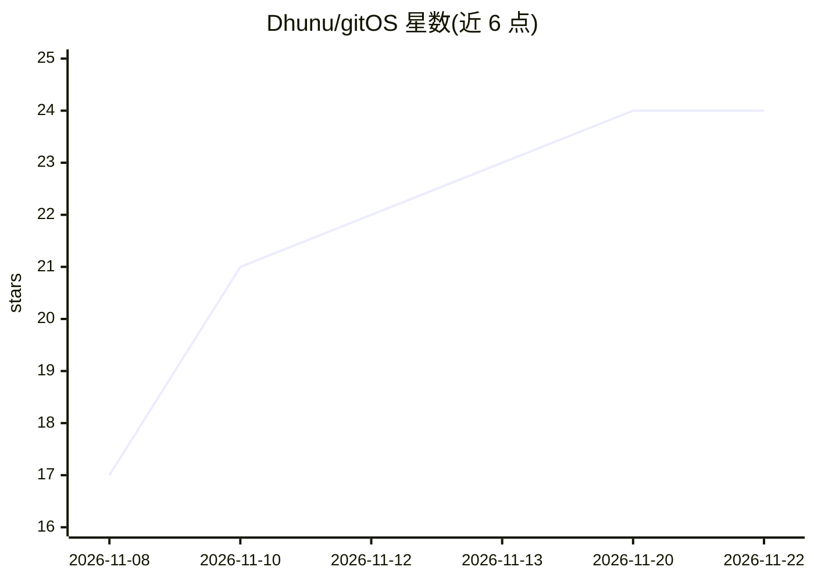

# Dhunu/gitOS

⭐ 24 · Swift · NOASSERTION · 推送 2026-11-21 · [GitHub](https://github.com/Dhunu/gitOS) · [官网](https://gitos.angelsaikia.com) · 个人维护

**原生 macOS Git 客户端：按文件夹/仓库自动切换 GitHub 多账号**

SwiftUI 编写的原生 macOS Git 客户端（需 macOS 26+、Apple Silicon），功能覆盖提交、diff、冲突编辑器、PR/issue/stash 查看等。核心机制是 GitHub 多账号管理：按文件夹规则或单仓库覆盖自动切换账号，令牌存于 macOS Keychain，不改写 ~/.gitconfig。AI 为可选功能：commit 信息与 PR 描述可调用已登录的 Claude Code 或 Codex CLI，或用 Anthropic API key。分发方式为 .dmg 安装包与 Homebrew cask。

## 筛选速览

| 维度 | 判定 | 备注 |
|---|---|---|
| AI 角色 | `ai-enhanced` | 去掉 AI 部分产品仍成立 |
| 许可风险 | `permissive` | NOASSERTION |
| 部署形态 | `desktop` | 安装包/桌面程序 |
| 模型依赖 | — | README 未给出锁定关系 |
| 硬件要求 | — | 无带数字的原话,不猜 |
| 安装摩擦 | `low` | 无编译、无系统依赖或容器化 |
| 成熟度 | — | 结构信号不足 |

## 能力要点

- 按文件夹规则或单仓库覆盖自动切换 GitHub 多账号
- 令牌存 Keychain，账号切换用 per-command -c 标志，不改写 ~/.gitconfig
- commit 信息与 PR 描述可调用 Claude Code / Codex CLI 或 Anthropic API key
- 提供 .dmg 下载与 Homebrew cask 安装，内置 OAuth Client ID

## 适用场景

- 同时使用多个 GitHub 账号的开发者免手动切换凭据
- 在原生 macOS 应用中完成提交、diff、冲突处理与 PR/issue 管理
- 让 AI 生成 commit 信息与 PR 描述

## 场景标签

 · 领域:开发者工具/Git 客户端

## 证据(README 行号)

> L3: A native macOS git client (SwiftUI, macOS 26+) in the spirit of GitHub Desktop, with
> L4: **multiple GitHub accounts that switch automatically per folder or repo**.
> L63: ✨ commit messages (⌘⇧G) and PR descriptions use whichever you pick in **Settings › AI**: the

## 星数曲线

2026-11-08 17 → 2026-11-22 24（+7）

---
*卡片 v1 · prompt 1.4 · 生成 2026-11-18 · 置信度 high · 依据 README sha `72c6f7ee40bb` · [字段定义](../../DATASET.md)*
