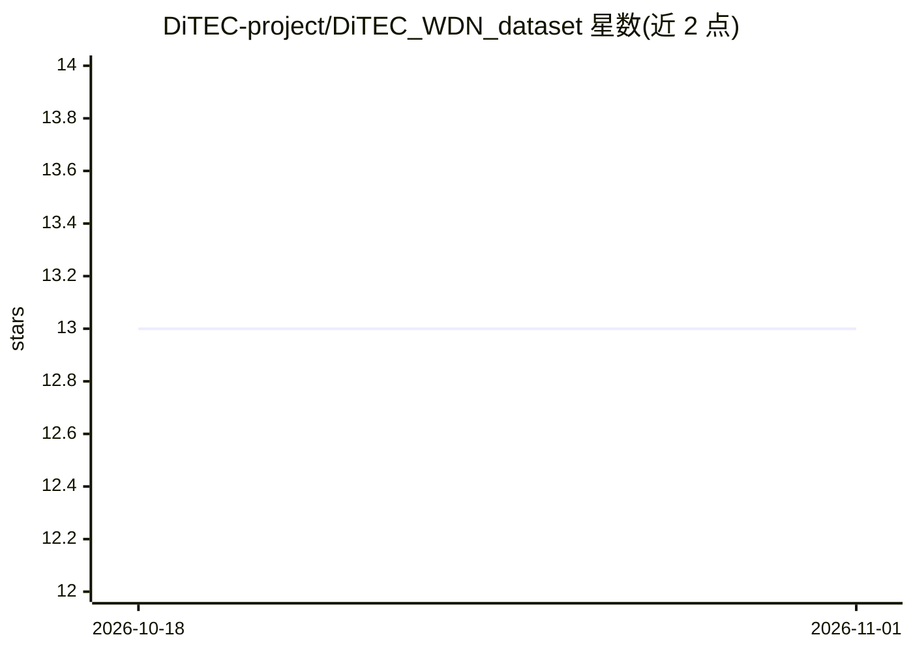

# DiTEC-project/DiTEC_WDN_dataset

⭐ 13 · Python · MIT · 推送 2026-10-31 · [GitHub](https://github.com/DiTEC-project/DiTEC_WDN_dataset) · [官网](https://huggingface.co/datasets/rugds/ditec-wdn) · 组织维护

**供水管网水力场景数据集的生成与仿真代码库**

DiTEC-WDN 论文的官方代码仓库，提供针对多个供水管网（WDN）大规模水力场景数据集的配置优化、场景生成与封装代码。用户可在自己的私有供水管网上生成场景数据；只需要数据本身的用户可直接引用已发布的数据集。代码按 arguments（配置）、core（接口、需水生成器、simgen）、inputs（原始 INP 文件）等目录组织，详细教程见项目 wiki。以 MIT 许可发布并提供 BibTeX 引用条目。

## 筛选速览

| 维度 | 判定 | 备注 |
|---|---|---|
| AI 角色 | `ai-knowledge` | 知识聚合/清单类 |
| 许可风险 | `permissive` | MIT |
| 部署形态 | `None` |  |
| 模型依赖 | — | README 未给出锁定关系 |
| 硬件要求 | — | 无带数字的原话,不猜 |
| 安装摩擦 | `low` | 无编译、无系统依赖或容器化 |
| 成熟度 | — | 结构信号不足 |

## 能力要点

- 提供 DiTEC-WDN 数据集的场景生成与封装代码
- 支持在用户私有供水管网上生成水力场景
- 配套项目 wiki 教程与 MIT 许可

## 适用场景

- 在私有供水管网上生成水力场景数据集
- 复现或扩展 DiTEC-WDN 数据集的生成流程
- 为时间序列预测/机器学习任务获取供水管网数据

## 场景标签

 · 领域:水务/数据集

## 证据(README 行号)

> L3: This is the official repository for the paper:
> L6: This repository contains configuration optimization, scenario generation, and encapsulation code for the **DiTEC-WDN

## 星数曲线

2026-10-18 13 → 2026-11-01 13（+0）

---
*卡片 v1 · prompt 1.4 · 生成 2026-10-31 · 置信度 high · 依据 README sha `8405a4eacc91` · [字段定义](../../DATASET.md)*
