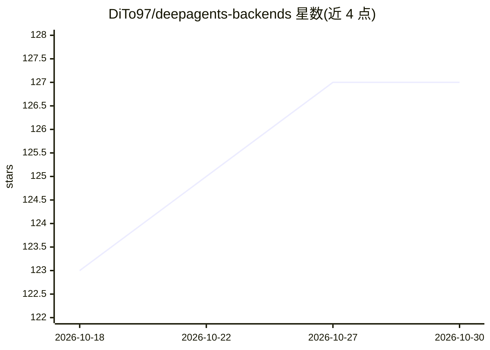

# DiTo97/deepagents-backends

⭐ 127 · Python · MIT · 推送 2026-07-15 · [GitHub](https://github.com/DiTo97/deepagents-backends) · [官网](https://dito97.github.io/deepagents-backends/) · 个人维护

**为 LangChain Deep Agents 提供远程存储后端：S3/PG/Azure/GCS/Mongo/Redis**

实现 Deep Agents 的 BackendProtocol，提供 S3/MinIO、PostgreSQL、Azure Blob、GCS、MongoDB、Redis/Valkey 六种远程存储后端，使 agent 文件可跨重启持久化、跨进程共享。全部后端实现同步与异步的完整协议方法（读写、编辑、glob、grep、上传下载等），支持按路径路由的混合组合后端，并附基准测试套件与本地 Docker 服务编排。以 Python 包形式通过 pip 安装，采用 MIT 许可。

## 筛选速览

| 维度 | 判定 | 备注 |
|---|---|---|
| AI 角色 | `ai-ecosystem` | LLM/agent 周边工具 |
| 许可风险 | `permissive` | MIT |
| 部署形态 | `self-host` | docker 或自建部署 |
| 模型依赖 | — | README 未给出锁定关系 |
| 硬件要求 | — | 无带数字的原话,不猜 |
| 安装摩擦 | `low` | 无编译、无系统依赖或容器化 |
| 成熟度 | — | 结构信号不足 |

## 能力要点

- 六种远程存储后端（S3/MinIO、PostgreSQL、Azure Blob、GCS、MongoDB、Redis/Valkey）
- 完整实现 BackendProtocol 的同步与异步方法
- Composite Backend 支持按路径将不同文件路由到不同后端
- 附延迟基准套件与本地 Docker 服务（MinIO/Azurite/fake-gcs-server 等）

## 适用场景

- 让 Deep Agents 的文件在重启与多进程部署间持久化
- 将 agent 工作区托管到云存储或数据库
- 本地用 Docker 模拟服务复现基准测试

## 场景标签

`Agent 记忆` · 领域:Agent 开发

## 证据(README 行号)

> L7: **deepagents-backends** provides production-ready remote implementations of the Deep Agents `BackendProtocol`, so ag
> L9: It currently ships backends for **S3 / MinIO**, **PostgreSQL**, **Azure Blob Storage**, **Google Cloud Storage**, **

## 星数曲线

2026-10-18 123 → 2026-10-30 127（+4）

---
*卡片 v1 · prompt 1.4 · 生成 2026-10-23 · 置信度 high · 依据 README sha `8fb01f34148c` · [字段定义](../../DATASET.md)*
