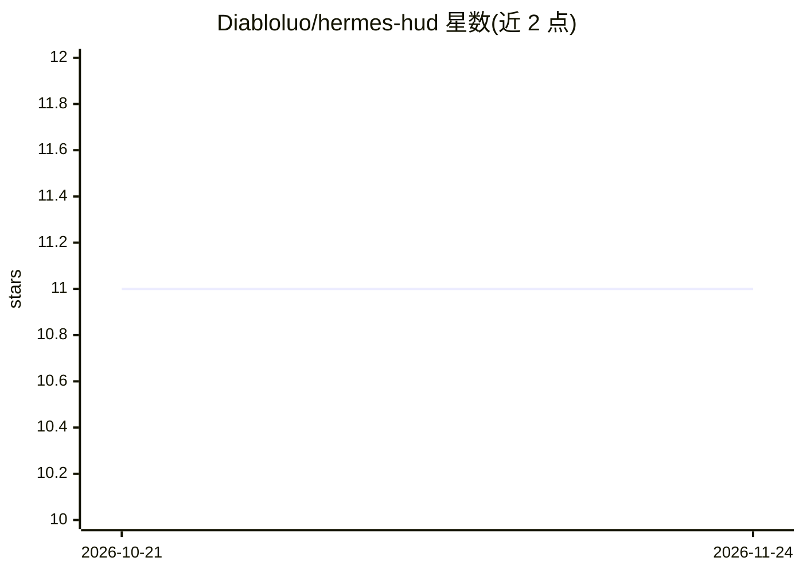

# Diabloluo/hermes-hud

⭐ 11 · Python · MIT · 推送 2026-11-21 · [GitHub](https://github.com/Diabloluo/hermes-hud) · [官网](https://github.com/Diabloluo/hermes-hud) · 个人维护 · 中文 README

**给 Hermes Agent 用户的本地实时运行监控面板**

以 Hermes Dashboard 用户级插件形式运行的本地可观测面板，只读读取 Hermes 的 SQLite 状态库、定时任务与日志，展示健康检查、实时事件流、Token/费用估算、会话与时间线、技能统计、渠道状态和错误事故。采用快照缓存加 WebSocket 增量推送实现约 2 秒级更新，数据全程只读、日志先脱敏、无出站遥测；可选脚本将事故推送到 Telegram 与飞书。通过 git clone 到插件目录安装，另提供 macOS arm64 桌面应用 Alpha。

## 筛选速览

| 维度 | 判定 | 备注 |
|---|---|---|
| AI 角色 | `ai-ecosystem` | LLM/agent 周边工具 |
| 许可风险 | `permissive` | MIT |
| 部署形态 | `None` |  |
| 模型依赖 | — | README 未给出锁定关系 |
| 硬件要求 | — | 无带数字的原话,不猜 |
| 安装摩擦 | `low` | 无编译、无系统依赖或容器化 |
| 成熟度 | `idea` | |

## 能力要点

- 多 Tab 一屏展示健康、Token/费用、会话、技能、定时任务、渠道与事故
- 只读访问核心数据（SQLite mode=ro），日志/密钥先脱敏，零出站遥测
- 2 秒级实时事件流（共享快照缓存 + WebSocket 增量）
- 可选 hud_alert.py 将事故/恢复推送到 Telegram 与飞书

## 适用场景

- 实时查看 Hermes Agent 的运行健康、会话与错误事故
- 按模型统计 Token 消耗与估算费用趋势并设预算阈值
- 排查定时任务失败与渠道抖动问题

## 场景标签

`LLM 可观测性` · 领域:评测与运维

## 证据(README 行号)

> L5: > 本地实时监控指挥中心 —— 把 Hermes Agent 的运行状态、Token/费用、模型、记忆、会话、定时任务、渠道、错误和机器健康完整摊开，异常发生时立即看见。
> L7: **不是 joeynyc/hermes-hud。** 那个是独立 TUI。本仓库是官方 `hermes dashboard` 的**用户级插件**：不替换 Dashboard、不改 `~/.hermes/hermes-agent` 
> L106: Hermes 现有数据源（只读）

## 星数曲线

2026-10-21 11 → 2026-11-24 11（+0）

---
*卡片 v1 · prompt 1.4 · 生成 2026-11-19 · 置信度 high · 依据 README sha `c95deb23bfd7` · [字段定义](../../DATASET.md)*
