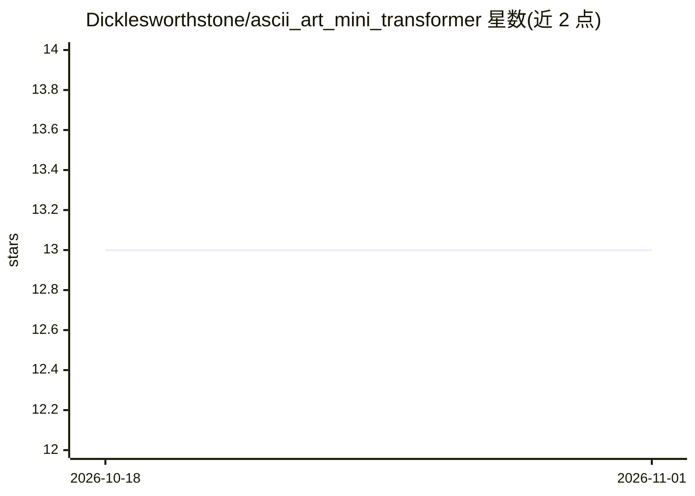

# Dicklesworthstone/ascii_art_mini_transformer

⭐ 13 · Python · NOASSERTION · 推送 2026-10-26 · [GitHub](https://github.com/Dicklesworthstone/ascii_art_mini_transformer) · 个人维护

**生成 ASCII 艺术的小型 CPU 友好 2D transformer**

训练一个小型 decoder-only transformer 生成 ASCII 艺术：采用字符级词表与 2D 位置编码（行+列），推理时逐步强制执行宽度/高度/最大字符数等硬约束。提供 Python 训练/导出管线与单一 Rust CLI 二进制（可内嵌权重），Python↔Rust 间用确定性 parity 测试防漂移。含数据抓取、SQLite 数据管线、导出 safetensors 及 int8/int4 量化。限制：无许可证文件（声明视为专有）、不接受外部贡献、无 Web UI、CPU 冒烟模型仅供验证而非艺术质量。

## 筛选速览

| 维度 | 判定 | 备注 |
|---|---|---|
| AI 角色 | `ai-native` | 本体是模型或模型工具 |
| 许可风险 | `none` | NOASSERTION |
| 部署形态 | `library` | 以包/库形式分发 |
| 模型依赖 | — | README 未给出锁定关系 |
| 硬件要求 | — | 无带数字的原话,不猜 |
| 安装摩擦 | `high` | 编译与系统依赖俱全 |
| 成熟度 | — | 结构信号不足 |

## 能力要点

- 2D 位置编码 + 字符级词表建模 ASCII 网格
- 解码逐步强制 width/height/max-chars 硬约束
- PyTorch 训练→导出 safetensors→Rust 单二进制推理，含 int8/int4 量化
- Python↔Rust 确定性 parity 测试防漂移

## 适用场景

- 在 CPU 上训练并运行生成满足严格行列约束的 ASCII 艺术
- 构建单文件 Rust CLI 分发带权重的 ASCII 生成器
- 从 ASCIIArt.eu、16colo.rs、HuggingFace 等来源构建训练数据集

## 场景标签

`模型训练` `模型量化` · 领域:训练与推理

## 证据(README 行号)

> L10: **ASCII Art Mini Transformer** trains a small, CPU-friendly decoder-only transformer and runs **constraint-respecti
> L12: Core idea: ASCII art is a **2D grid** (rows/columns), not just a 1D token stream — so this project uses **character

## 星数曲线

2026-10-18 13 → 2026-11-01 13（+0）

---
*卡片 v1 · prompt 1.4 · 生成 2026-10-31 · 置信度 high · 依据 README sha `1ad74e94fa4a` · [字段定义](../../DATASET.md)*
