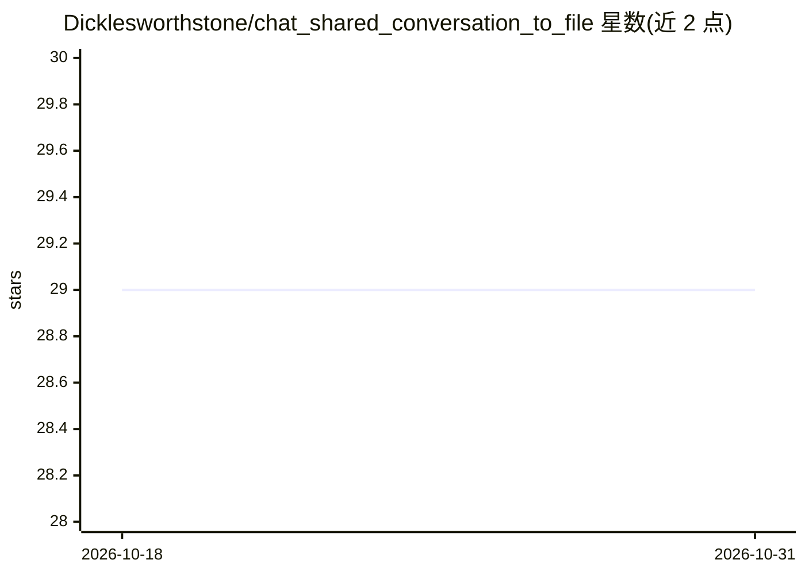

# Dicklesworthstone/chat_shared_conversation_to_file

⭐ 29 · TypeScript · NOASSERTION · 推送 2026-10-23 · [GitHub](https://github.com/Dicklesworthstone/chat_shared_conversation_to_file) · 个人维护

**把 AI 聊天分享链接转为 Markdown/HTML 转录的 CLI 工具**

单文件 Bun 实现的命令行工具：接收 ChatGPT、Gemini、Grok、Claude 的公开分享链接，用 Playwright 无头 Chromium 抓取页面（Claude 因 Cloudflare 防护改用本机 Chrome 会话 cookie + DevTools 协议），按各家选择器抽取用户/助手消息，生成保留代码围栏语言的 Markdown 与零 JS 的静态 HTML 双文件，文件名 slug 化并自动去重。可选一条命令发布到 GitHub Pages 生成索引微站。面向需要归档、引用或托管 AI 对话的用户，需安装脚本安装，Claude 路径要求本机已装 Chrome 并登录。

## 筛选速览

| 维度 | 判定 | 备注 |
|---|---|---|
| AI 角色 | `ai-ecosystem` | LLM/agent 周边工具 |
| 许可风险 | `none` | NOASSERTION |
| 部署形态 | `None` |  |
| 模型依赖 | locked-api |  |
| 硬件要求 | — | 无带数字的原话,不猜 |
| 安装摩擦 | `low` | 无编译、无系统依赖或容器化 |
| 成熟度 | — | 结构信号不足 |

## 能力要点

- 支持 ChatGPT/Gemini/Grok/Claude 四家公开分享链接，URL 自动识别提供商
- Claude 路径通过复制 Chrome 会话 cookie + CDP 绕过 Cloudflare 防护
- 确定性 slug 文件名 + 冲突自动后缀，temp+rename 原子写入
- 可选 --publish-to-gh-pages 一键发布为带索引的静态微站

## 适用场景

- 把 AI 聊天分享链接转成干净的 Markdown 归档或引用
- 生成零 JS 的静态 HTML 转录页用于托管或打印
- 一条命令把多个 AI 对话发布成 GitHub Pages 微站

## 场景标签

 · 领域:开发工具/文档转换

## 证据(README 行号)

> L8: Single-file Bun-native CLI that turns public ChatGPT, Gemini, Grok, and Claude share links into clean Markdown + HTM
> L34: - Selector strategy: provider-specific selectors with fallback chains—ChatGPT uses `article [data-message-author-ro
> L43: **For ChatGPT, Gemini, and Grok:**

## 星数曲线

2026-10-18 29 → 2026-10-31 29（+0）

---
*卡片 v1 · prompt 1.4 · 生成 2026-10-26 · 置信度 high · 依据 README sha `ebdd3dcd324b` · [字段定义](../../DATASET.md)*
