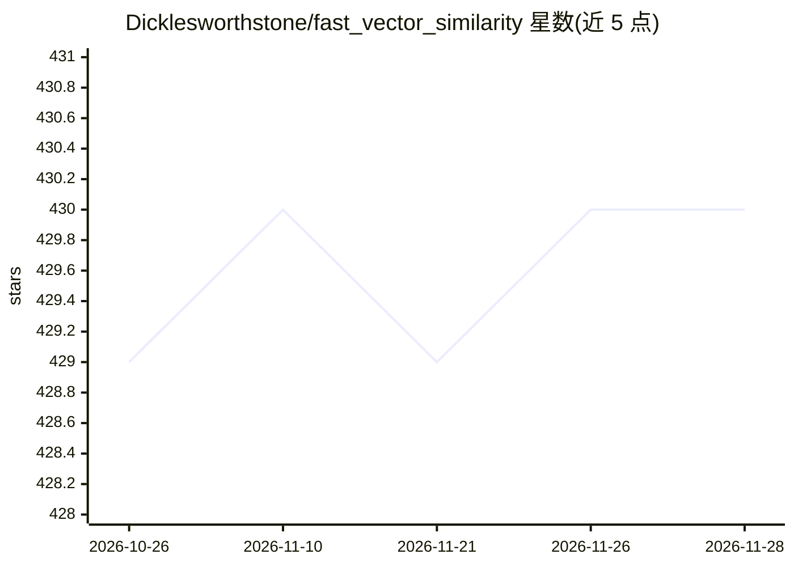

# Dicklesworthstone/fast_vector_similarity

⭐ 430 · Rust · 推送 2026-11-26 · [GitHub](https://github.com/Dicklesworthstone/fast_vector_similarity) · [官网](https://pypi.org/project/fast-vector-similarity/) · 个人维护

**Rust 向量相似度计算库，含 Python 绑定与 bootstrap 区间**

以 Rust 实现的向量相似度度量库，提供 Spearman、Kendall Tau（tau-b）、近似距离相关、Jensen-Shannon、Hoeffding's D、归一化互信息等度量，并用 bootstrap 重采样估计度量的均值与标准差。通过 rayon 并行与 merge sort 反演计数做性能优化，含基准测试套件验证数值正确性。提供 Python 绑定（PyPI 包），函数返回 JSON 结果；文档给出 LLM 文本嵌入向量的分析工作流，并详细规定了非有限值、常量向量、样本量不足等未定义情形的处理。适用于需在 Rust 或 Python 中计算向量相似度的开发者与数据/ML 工程场景。

## 筛选速览

| 维度 | 判定 | 备注 |
|---|---|---|
| AI 角色 | `ai-native` | 本体是模型或模型工具 |
| 许可风险 | `none` | — |
| 部署形态 | `library` | 以包/库形式分发 |
| 模型依赖 | — | README 未给出锁定关系 |
| 硬件要求 | — | 无带数字的原话,不猜 |
| 安装摩擦 | `low` | 无编译、无系统依赖或容器化 |
| 成熟度 | — | 结构信号不足 |

## 能力要点

- 实现 6 种相似度/相关性度量，含 tau-b 与并列值修正
- bootstrap 重采样输出均值与标准差，截尾规则明确
- rayon 并行与 O(n log n) 反演计数优化
- Python 绑定经 PyPI 安装，返回 JSON 并对无效输入抛 ValueError

## 适用场景

- 对 LLM 生成的文本嵌入向量做相似度排序分析
- 数据分析中计算变量间非线性和秩相关性
- 需要带 bootstrap 置信信息的相似度统计时调用

## 场景标签

`语义搜索` `数据分析` · 领域:效率与自动化

## 证据(README 行号)

> L5: The Fast Vector Similarity Library is a high-performance Rust-based tool for efficiently computing similarity measur
> L67: This library is highly compatible with modern language models like Llama2, enabling easy analysis of text embedding

## 星数曲线

2026-10-26 429 → 2026-11-28 430（+1）

---
*卡片 v1 · prompt 1.4 · 生成 2026-11-27 · 置信度 mid · 依据 README sha `7278d4d52938` · [字段定义](../../DATASET.md)*
