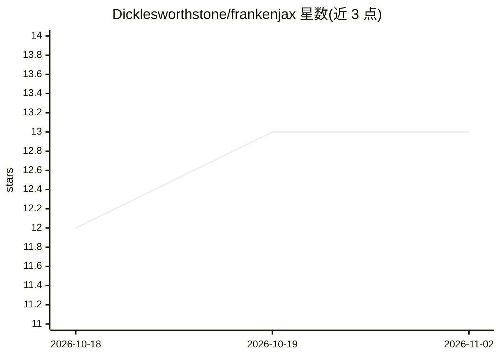

# Dicklesworthstone/frankenjax

⭐ 13 · Rust · NOASSERTION · 推送 2026-10-26 · [GitHub](https://github.com/Dicklesworthstone/frankenjax) · 个人维护

**JAX 变换语义（jit/grad/vmap）的 Rust 净室参考实现**

以 Rust 从零重实现 JAX 的变换组合语义：提供 157 个 V1 本地原语的求值与完整 VJP/JVP/符号微分，配套类 JAXPR 规范 IR、Trace Transform Ledger 审计证据、E-graph 等式饱和优化器与 861 条对真实 JAX oracle 的差分一致性测试。共 17 个 workspace crate，含 C FFI 与 PyO3 绑定，无 Python/XLA 运行时依赖。面向编译器研究者、需要无 Python 自动微分的 Rust 开发者与验证工程师；作者声明其为参考实现而非生产 ML 训练替代品，pmap 集体通信在无多设备上下文时 fail closed。

## 筛选速览

| 维度 | 判定 | 备注 |
|---|---|---|
| AI 角色 | `ai-ecosystem` | LLM/agent 周边工具 |
| 许可风险 | `none` | NOASSERTION |
| 部署形态 | `library` | 以包/库形式分发 |
| 模型依赖 | — | README 未给出锁定关系 |
| 硬件要求 | — | 无带数字的原话,不猜 |
| 安装摩擦 | `medium` | 含编译或系统依赖之一 |
| 成熟度 | — | 结构信号不足 |

## 能力要点

- 157 个 V1 原语全部具备 VJP/JVP 与符号 grad_to_jaxpr 微分规则
- 861 条 JAX 0.9.2 oracle fixture 差分一致性验证
- Trace Transform Ledger 产出可审计的变换组合证据链
- 无 Python/XLA 运行时依赖，提供 C FFI 与 PyO3 绑定

## 适用场景

- 在 Rust 应用中嵌入 jit/grad/vmap 自动微分而无需 Python
- 研究 jit/grad/vmap 等变换的组合语义与 IR 设计
- 作为验证 oracle 或教学材料理解可组合变换

## 场景标签

`科研工具` · 领域:学习与行业

## 证据(README 行号)

> L17: **The problem:** JAX's transform semantics (`jit`, `grad`, `vmap`) are deeply entangled with Python and XLA. There'
> L19: **The solution:** FrankenJAX extracts and reimplements JAX's transform composition model in Rust with a canonical J
> L49: FrankenJAX is not a replacement for JAX in production ML training. It is a **reference implementation** of JAX's ma

## 星数曲线

2026-10-18 12 → 2026-11-02 13（+1）

---
*卡片 v1 · prompt 1.4 · 生成 2026-10-31 · 置信度 mid · 依据 README sha `a8aa56aba203` · [字段定义](../../DATASET.md)*
