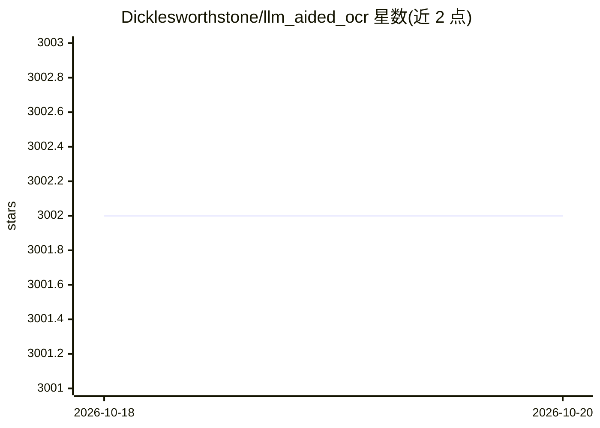

# Dicklesworthstone/llm_aided_ocr

⭐ 3,002 · Python · NOASSERTION · 推送 2026-10-14 · [GitHub](https://github.com/Dicklesworthstone/llm_aided_ocr) · 个人维护

**用 LLM 修正 Tesseract OCR 结果并输出 Markdown 的文档处理工具**

扫描 PDF 文档处理流水线：将 PDF 转图、Tesseract 提取文本后，按句块切分，用 LLM（本地 GGUF 模型经 llama-cpp-python，或 OpenAI/Anthropic API）做 OCR 纠错与可选 Markdown 格式化，再做去重、页眉页码清除、确定性接缝拼接与内容保持度评估。支持异步并发与重试，通过 .env 配置。面向需要将扫描件转为可读文本的开发者/科研用户，需自装 Tesseract。

## 筛选速览

| 维度 | 判定 | 备注 |
|---|---|---|
| AI 角色 | `ai-native` | 本体是模型或模型工具 |
| 许可风险 | `none` | NOASSERTION |
| 部署形态 | `None` |  |
| 模型依赖 | local-ok | 支持本地模型 |
| 硬件要求 | — | 无带数字的原话,不猜 |
| 安装摩擦 | `low` | 无编译、无系统依赖或容器化 |
| 成熟度 | — | 结构信号不足 |

## 能力要点

- PDF→图像→Tesseract OCR→LLM 两步纠错与 Markdown 格式化
- 支持本地 GGUF 模型（llama-cpp-python）与 OpenAI/Anthropic API
- 图像预处理（灰度、去斜、CLAHE、Otsu 二值化）与页眉/页码清除
- 确定性内容保持度与语义相似度质量评估

## 适用场景

- 把扫描 PDF 或书籍转成干净的 Markdown 文本
- 修正 OCR 错误以获得可检索、可引用的文档文本
- 离线用本地 LLM 处理敏感文档而不调用云端 API

## 场景标签

`OCR` `文档解析` `科研工具` · 领域:知识与检索

## 证据(README 行号)

> L19: - Advanced error correction using LLMs (local or API-based)
> L74:  - Supports both local LLMs and cloud-based API providers (OpenAI, Anthropic)
> L199: 1. **PDF Conversion**: Converts input PDF into images at configurable DPI (`PDF_DPI=300` by default) using `pdf2im

## 星数曲线

2026-10-18 3,002 → 2026-10-20 3,002（+0）

---
*卡片 v1 · prompt 1.4 · 生成 2026-10-20 · 置信度 high · 依据 README sha `0b3efac655d3` · [字段定义](../../DATASET.md)*
