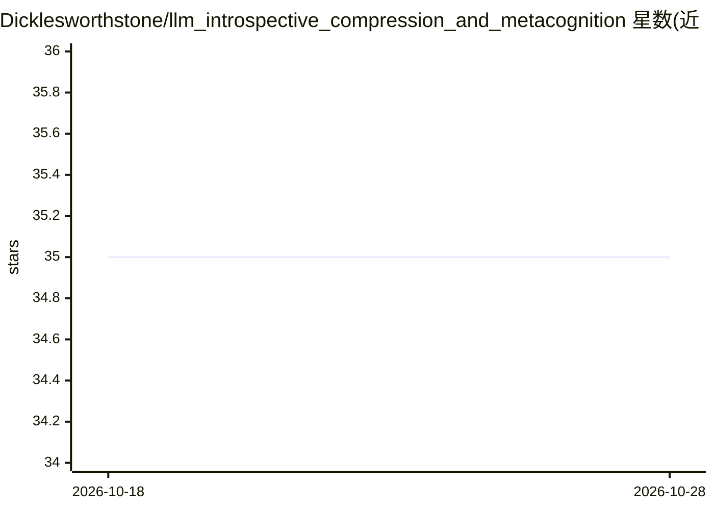

# Dicklesworthstone/llm_introspective_compression_and_metacognition

⭐ 35 · NOASSERTION · 推送 2026-03-22 · [GitHub](https://github.com/Dicklesworthstone/llm_introspective_compression_and_metacognition) · 个人维护

**面向研究者的 transformer 内部状态压缩与内省方法提案**

一篇技术提案文章加原型代码：通过在冻结的宿主 transformer 旁训练轻量 sidecar 编码器/解码器，将内部状态（选定层隐藏状态与 KV 缓存）压缩为低维潜变量 z_t 并以高保真（而非精确）方式重建。文中给出三种架构（逐层/分组/统一压缩器）与专门的 KV 缓存压缩模块，损失函数权衡隐藏状态、KV 重建误差与潜变量正则项。训练可用 OpenWebText 等语料。应用方向包括推理回溯、思维轨迹上的强化学习与因果调试。README 未提供安装命令或完整可运行库，性能数字为初步实验估计。

## 筛选速览

| 维度 | 判定 | 备注 |
|---|---|---|
| AI 角色 | `ai-ecosystem` | LLM/agent 周边工具 |
| 许可风险 | `none` | NOASSERTION |
| 部署形态 | `None` |  |
| 模型依赖 | — | README 未给出锁定关系 |
| 硬件要求 | — | 无带数字的原话,不猜 |
| 安装摩擦 | `low` | 无编译、无系统依赖或容器化 |
| 成熟度 | `idea` | |

## 能力要点

- sidecar 编码器/解码器将宿主 transformer 内部状态压缩为潜变量并重建
- 三种压缩架构：逐层、分组（默认推荐）、统一编码器/解码器
- 专门的 KV 缓存序列感知压缩模块
- 应用方向：推理回溯、潜思维轨迹 RL、因果调试

## 适用场景

- 研究 transformer 内部表示与可解释性
- 保存与重放模型中间状态以回溯推理路径
- 在潜思维空间上做元级优化实验

## 场景标签

`科研工具` · 领域:学习与行业

## 证据(README 行号)

> L13: 1. **Lack of Introspection**: Unless specifically instrumented, transformer-based LLMs have no ability to explicitl
> L181: A full implementation would incorporate these components into a reusable library that interfaces with major transf

## 星数曲线

2026-10-18 35 → 2026-10-28 35（+0）

---
*卡片 v1 · prompt 1.4 · 生成 2026-10-25 · 置信度 mid · 依据 README sha `550ee07de0ff` · [字段定义](../../DATASET.md)*
