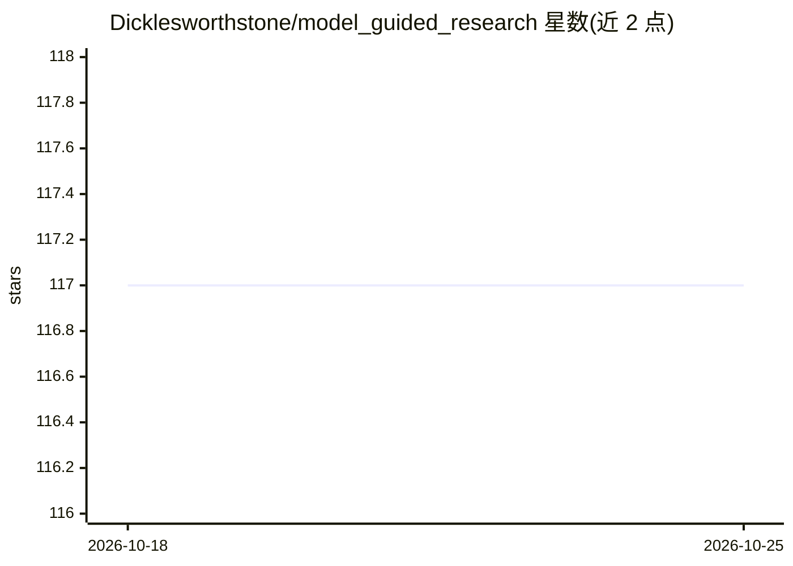

# Dicklesworthstone/model_guided_research

⭐ 117 · Python · NOASSERTION · 推送 2026-10-16 · [GitHub](https://github.com/Dicklesworthstone/model_guided_research) · 个人维护

**13 种 exotic 数学框架在深度学习中的系统性研究与双实现**

源于人类与 GPT-5 Pro 协作的数学探索实验：对 Lie 群、p-adic 超度量、热带几何、单纯复形、四元数/八元数、超限序数调度等 13 个数学框架进行 JAX 探索性演示与 PyTorch 生产实现的 双轨实现。PyTorch 侧为统一 GPT 架构 nanochat，支持 13 种可切换注意力机制、多优化器与调度器、A/B 实验矩阵与基准设施；通过 mgr 命令与 CLI 运行演示和训练。要求 Python 3.13+ 与 uv，GPU 为可选。

## 筛选速览

| 维度 | 判定 | 备注 |
|---|---|---|
| AI 角色 | `ai-native` | 本体是模型或模型工具 |
| 许可风险 | `none` | NOASSERTION |
| 部署形态 | `None` |  |
| 模型依赖 | — | README 未给出锁定关系 |
| 硬件要求 | — | 无带数字的原话,不猜 |
| 安装摩擦 | `medium` | 含编译或系统依赖之一 |
| 成熟度 | — | 结构信号不足 |

## 能力要点

- 每个框架提供 JAX 演示与 PyTorch 注意力机制双实现
- nanochat 统一 GPT 架构，运行时切换 13 种注意力类型
- p-adic 超度量实现 O(N log N) 次二次注意力
- simplicial/fractal/surreal 机制含 proxy 与 faithful 两档实现

## 适用场景

- 研究 exotic 数学结构在 Transformer 注意力中的应用
- A/B 对比不同数学注意力机制的训练效果
- 以交互演示学习相关数学基础并验证性质

## 场景标签

`科研工具` · 领域:学习与行业

## 证据(README 行号)

> L43: - Production-ready GPT transformer in PyTorch
> L87: python -m nanochat.train --attention-type tropical --optimizer-type hoss

## 星数曲线

2026-10-18 117 → 2026-10-25 117（+0）

---
*卡片 v1 · prompt 1.4 · 生成 2026-10-23 · 置信度 high · 依据 README sha `d6e90ed579bd` · [字段定义](../../DATASET.md)*
