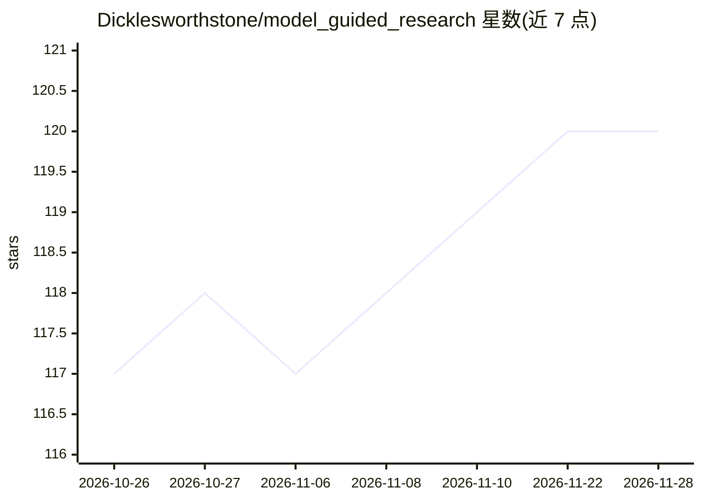

# Dicklesworthstone/model_guided_research

⭐ 120 · Python · NOASSERTION · 推送 2026-11-26 · [GitHub](https://github.com/Dicklesworthstone/model_guided_research) · 个人维护

**面向深度学习研究者的 13 个数学框架系统实验库（JAX+PyTorch 双实现）**

以'AI 作为数学研究伙伴'流程驱动的实验性研究项目：将李群/李代数、p-adic 数、热带代数、超度量空间等 13 个数学结构实现为深度学习组件。第一阶段是 JAX 独立演示（含可视化与性质校验），第二阶段在 PyTorch nanochat 中实现统一 GPT，支持 13 种可切换注意力机制、HOSS 优化器与 ordinal 调度器，第三阶段提供固定预算 A/B 测试的基准设施与假设/定理注册表。需 Python 3.13+ 与 uv，CUDA GPU 为训练可选项。

## 筛选速览

| 维度 | 判定 | 备注 |
|---|---|---|
| AI 角色 | `ai-native` | 本体是模型或模型工具 |
| 许可风险 | `none` | NOASSERTION |
| 部署形态 | `library` | 以包/库形式分发 |
| 模型依赖 | — | README 未给出锁定关系 |
| 硬件要求 | — | 无带数字的原话,不猜 |
| 安装摩擦 | `medium` | 含编译或系统依赖之一 |
| 成熟度 | `idea` | |

## 能力要点

- JAX 演示与 PyTorch transformer 双实现，13 种注意力类型运行时切换
- 内置假设/定理注册表，支持校验命令（mgr theorems/hypotheses validate）
- mgr CLI 统一管理演示列表、运行与批处理
- 提供 wheel 构建供其他 uv 项目消费

## 适用场景

- 系统性对比不同数学结构的注意力机制在同一 transformer 上的表现
- 交互式学习李群、热带代数等数学结构的可运行演示
- 在固定训练预算下做可复现的 A/B 实验与假设验证

## 场景标签

`科研工具` · 领域:学习与行业

## 证据(README 行号)

> L36: **Phase 1: Mathematical Exploration (JAX Demos)**
> L43: - Trainable GPT transformer in PyTorch
> L56: The project explores the frameworks in JAX and implements trainable mechanisms, blocks, an optimizer and a schedule

## 星数曲线

2026-10-26 117 → 2026-11-28 120（+3）

---
*卡片 v1 · prompt 1.4 · 生成 2026-11-28 · 置信度 high · 依据 README sha `3196d0e33c7e` · [字段定义](../../DATASET.md)*
