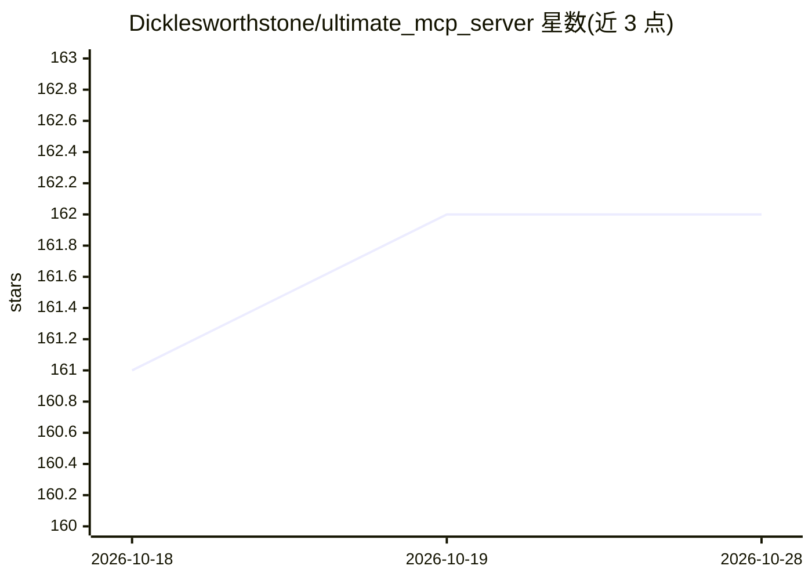

# Dicklesworthstone/ultimate_mcp_server

⭐ 162 · Python · NOASSERTION · 推送 2026-10-14 · [GitHub](https://github.com/Dicklesworthstone/ultimate_mcp_server) · 个人维护

**面向 AI agent 的综合 MCP 服务器：多 LLM 接入与认知增强工具集**

基于 Model Context Protocol 的 Python MCP 服务器，将数十种能力以标准化 MCP 工具暴露给 Claude 等 AI agent：多 LLM 提供商统一接入与任务委派（含 OpenAI/Anthropic/Google/DeepSeek/xAI/OpenRouter 及本地 OpenAI 兼容服务）、Playwright 浏览器自动化、Excel 操作、OCR、向量检索与 RAG、SQL 数据库、文件系统操作、认知记忆系统（工作/情景/语义/程序性记忆）与锦标赛式多模型评测。通过任务路由与多层缓存进行成本优化，本地推理按 $0 计费以优先委派。要求 Python 3.13+，MIT 许可。

## 筛选速览

| 维度 | 判定 | 备注 |
|---|---|---|
| AI 角色 | `ai-ecosystem` | LLM/agent 周边工具 |
| 许可风险 | `permissive` | NOASSERTION |
| 部署形态 | `library` | 以包/库形式分发 |
| 模型依赖 | local-ok | 支持本地模型 |
| 硬件要求 | — | 无带数字的原话,不猜 |
| 安装摩擦 | `low` | 无编译、无系统依赖或容器化 |
| 成熟度 | — | 结构信号不足 |

## 能力要点

- 统一接口接入 OpenAI/Anthropic/Google/DeepSeek/xAI/OpenRouter 及本地 OpenAI 兼容服务器
- 认知记忆系统（工作/情景/语义/程序性层级）与跨步骤状态保持
- Playwright 浏览器自动化、Excel/OCR/向量检索/SQL 等数十种 MCP 工具
- 任务委派、多层缓存与锦标赛式多模型评测实现成本优化

## 适用场景

- 让 Claude 等 agent 通过一个 MCP 服务器调用浏览器、文档、数据库等多种工具
- 将成本敏感任务路由到廉价模型或本地模型以降低 API 开销
- 为 agent 构建持久化记忆与多步骤工作流编排

## 场景标签

`浏览器自动化` `RAG` `OCR` `模型网关` · 领域:Agent 开发

## 证据(README 行号)

> L7: ### A comprehensive Model Context Protocol (MCP) server providing advanced AI agents with dozens of powerful capabil
> L38: The server is built entirely on the Model Context Protocol (MCP), making it specifically designed to work with AI a
> L89: - 🔗 Standard API for **OpenAI**, **Anthropic (Claude)**, **Google (Gemini)**, **xAI (Grok)**, **DeepSeek**, **OpenR

## 星数曲线

2026-10-18 161 → 2026-10-28 162（+1）

---
*卡片 v1 · prompt 1.4 · 生成 2026-10-23 · 置信度 high · 依据 README sha `32eaa41585a0` · [字段定义](../../DATASET.md)*
