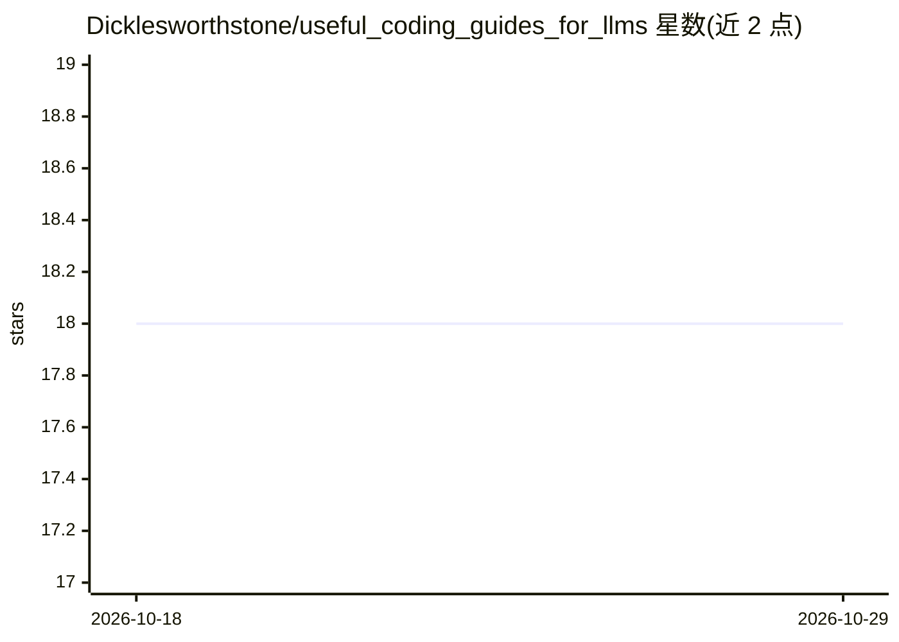

# Dicklesworthstone/useful_coding_guides_for_llms

⭐ 18 · NOASSERTION · 推送 2026-07-24 · [GitHub](https://github.com/Dicklesworthstone/useful_coding_guides_for_llms) · 个人维护

**面向人类与 LLM 编码助手协作的 Next.js 15 最佳实践指南库**

由个人维护的文档型仓库：核心是一份近千行的 Next.js 15 / App Router / Zustand 最佳实践指南，另附实施进度核对清单、用于生成与修订指南的种子提示词，以及在 Claude Code 中应用该方法的对话实录。工作流为：将完整指南与进度文档载入模型上下文，让编码助手按指南实施并逐项更新进度，以充足上下文减少幻觉。指南由多个模型（Claude Opus 4、GPT-4o、Gemini Deep Research）的调研结果合并而成，覆盖服务端优先取数、Server Actions、缓存、Zustand 状态管理等主题。仓库为纯文档，无可安装代码。

## 筛选速览

| 维度 | 判定 | 备注 |
|---|---|---|
| AI 角色 | `ai-knowledge` | 知识聚合/清单类 |
| 许可风险 | `none` | NOASSERTION |
| 部署形态 | `None` |  |
| 模型依赖 | — | README 未给出锁定关系 |
| 硬件要求 | — | 无带数字的原话,不猜 |
| 安装摩擦 | `low` | 无编译、无系统依赖或容器化 |
| 成熟度 | — | 结构信号不足 |

## 能力要点

- 近千行 Next.js 15 最佳实践指南（架构、Server Actions、缓存、Zustand）
- 配套实施进度核对清单，用于跟踪模式落地情况
- 提供与 Claude Code 等 agentic 编码工具协作的工作流与示例转录
- 指南由多个模型的调研结果合并修订而成

## 适用场景

- 让 Claude Code 等 AI 编码助手按统一规范改造 Next.js 项目
- 团队建立 Next.js 15 架构与模式的参考基准
- 学习如何用文档+进度跟踪的方式引导 AI 完成大型重构

## 场景标签

`教程课程` · 领域:学习与行业

## 证据(README 行号)

> L3: This repository contains a growing body of documentation about how to build robust, maintainable Next.js 15 applicat
> L7: * **NEXTJS15_BEST_PRACTICES.md** – a nearly 1000 line guide describing recommended architecture and patterns for mod
> L46: The reason this repository places such emphasis on comprehensive documentation is that modern large language models

## 星数曲线

2026-10-18 18 → 2026-10-29 18（+0）

---
*卡片 v1 · prompt 1.4 · 生成 2026-10-29 · 置信度 high · 依据 README sha `56bed410330b` · [字段定义](../../DATASET.md)*
