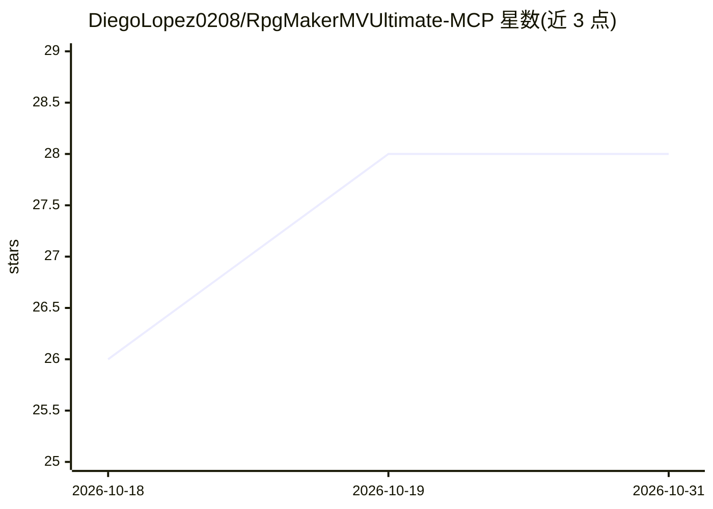

# DiegoLopez0208/RpgMakerMVUltimate-MCP

⭐ 28 · TypeScript · MIT · 推送 2026-10-12 · [GitHub](https://github.com/DiegoLopez0208/RpgMakerMVUltimate-MCP) · [官网](https://www.npmjs.com/package/rpgmaker-mv-mcp) · 个人维护

**让 AI agent 检查、编辑并试玩 RPG Maker MV 项目的 MCP 服务器**

一个 Model Context Protocol 服务器，通过 18 个整合工具让 AI agent 读写磁盘上的真实 RPG Maker MV 项目：生成地图（106 个 RTP 模板克隆或语义布局两条路径）、以真实 ID 编辑数据库与事件、离线分析项目一致性问题（断链转移、开关从未置位、不可达地图等）。附带 live bridge 插件：试玩中回传异常、玩家位置、截图与录屏，并支持不丢进度的地图热重载。面向 MV 1.6.1 项目开发者，需 Node.js 20.19.0+，编辑前需关闭 MV 编辑器；生成的数据仍需在项目的图块集与插件中验证。

## 筛选速览

| 维度 | 判定 | 备注 |
|---|---|---|
| AI 角色 | `ai-ecosystem` | LLM/agent 周边工具 |
| 许可风险 | `permissive` | MIT |
| 部署形态 | `library` | 以包/库形式分发 |
| 模型依赖 | — | README 未给出锁定关系 |
| 硬件要求 | — | 无带数字的原话,不猜 |
| 安装摩擦 | `low` | 无编译、无系统依赖或容器化 |
| 成熟度 | — | 结构信号不足 |

## 能力要点

- 18 个整合工具：构建（地图/事件/数据库）、理解（离线项目分析）、观察（试玩遥测）
- 地图生成支持 RTP 模板克隆与任务图驱动的语义布局（同 seed 可复现）
- live bridge 回传异常堆栈、玩家位置、截图与 WebM 录屏，支持地图热重载不丢存档
- read-only 的 analyze_project 提供 validate/explain/usage/balance 等 13 种视图

## 适用场景

- 排查 MV 事件不触发、地图不可达、引用断裂等问题
- 让 agent 按主题批量生成地图并布线事件
- 在真实引擎中试玩验证修改并留存截图/录屏证据

## 场景标签

`编码 Agent` `代码审查` · 领域:编码与开发

## 证据(README 行号)

> L18: A Model Context Protocol server that lets an AI agent inspect and edit a **real RPG Maker MV project on disk** thro
> L85: Works with Claude Desktop, Claude Code, opencode, and any MCP-compatible client.

## 星数曲线

2026-10-18 26 → 2026-10-31 28（+2）

---
*卡片 v1 · prompt 1.4 · 生成 2026-10-26 · 置信度 high · 依据 README sha `9ee6da6602f8` · [字段定义](../../DATASET.md)*
