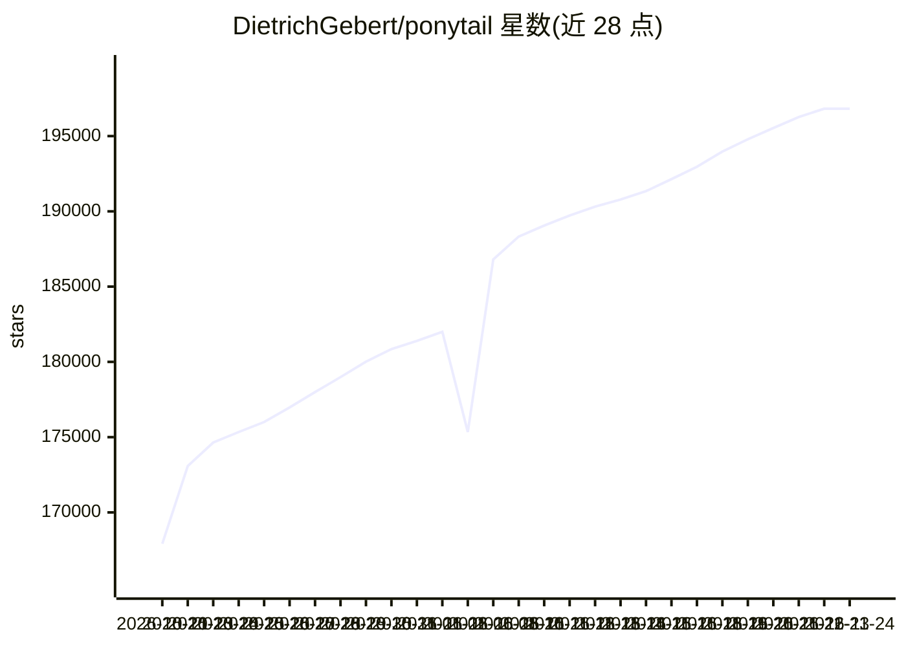

# DietrichGebert/ponytail

⭐ 196,817 · JavaScript · MIT · 推送 2026-11-22 · [GitHub](https://github.com/DietrichGebert/ponytail) · [官网](https://ponytail.dev) · 个人维护 · 中文 README

**给 AI 编码代理注入最小化编码风格的技术栈提示词与技能包**

Ponytail 是一个以提示词为核心的技能包：主体是 skills/ponytail/SKILL.md 与精简版 AGENTS.md，通过插件市场或复制文件加载到 Claude Code、Codex 及其他技能型代理中。写入代理遵循七级复用阶梯（不新写、复用库内代码、标准库、平台特性、已有依赖、一行实现、最小实现），并保留校验、安全与测试。附带 /ponytail-review、/ponytail-audit、/ponytail-debt 等命令，以及在 Claude Code 中显示成本/令牌/复用率的 band 面板。需支持技能的宿主代理，仅 MIT 单许可。

## 筛选速览

| 维度 | 判定 | 备注 |
|---|---|---|
| AI 角色 | `ai-ecosystem` | LLM/agent 周边工具 |
| 许可风险 | `permissive` | MIT |
| 部署形态 | `desktop` | 安装包/桌面程序 |
| 模型依赖 | — | README 未给出锁定关系 |
| 硬件要求 | — | 无带数字的原话,不猜 |
| 安装摩擦 | `low` | 无编译、无系统依赖或容器化 |
| 成熟度 | — | 结构信号不足 |

## 动量与使用信号

- 维护:`active` — 距上次 push 1.3 天,年发版 29,128 位贡献者
- 涨星:近 1 天 **+1,217**(自 20261016 起算)
- 安装:github 包 `release-assets` 月下载无数据

## 能力要点

- 七级复用阶梯：优先复用现有代码/标准库/平台特性，仅写任务所需代码
- /ponytail-review 读取变更触及的全部代码，检查 bug、安全、负载、缺测试
- Claude Code 专属 band 面板显示成本、令牌、代理时间与复用率
- 单个提示词文件分发：SKILL.md / AGENTS.md 适配 20 种代理

## 适用场景

- 让编码代理少写不必要的代码并降低成本与令牌消耗
- 对当前 diff 或整个仓库做缺陷与安全审查
- 收集代码中的 shortcut 注释形成技术债台账

## 场景标签

`提示工程` `代码审查` · 领域:Agent 开发

## 证据(README 行号)

> L106: Ponytail is one prompt: `skills/ponytail/SKILL.md`. The compact version, for agents that read a rules file, is `AG
> L149: Commands need a skill-capable host (Claude Code, Codex, Devin CLI, OpenCode, Gemini, Antigravity CLI, pi, Hermes A

## 星数曲线

2026-10-21 167,924 → 2026-11-24 196,817（+28,893）

---
*卡片 v1 · prompt 1.4 · 生成 2026-11-23 · 置信度 high · 依据 README sha `247186191877` · [字段定义](../../DATASET.md)*
