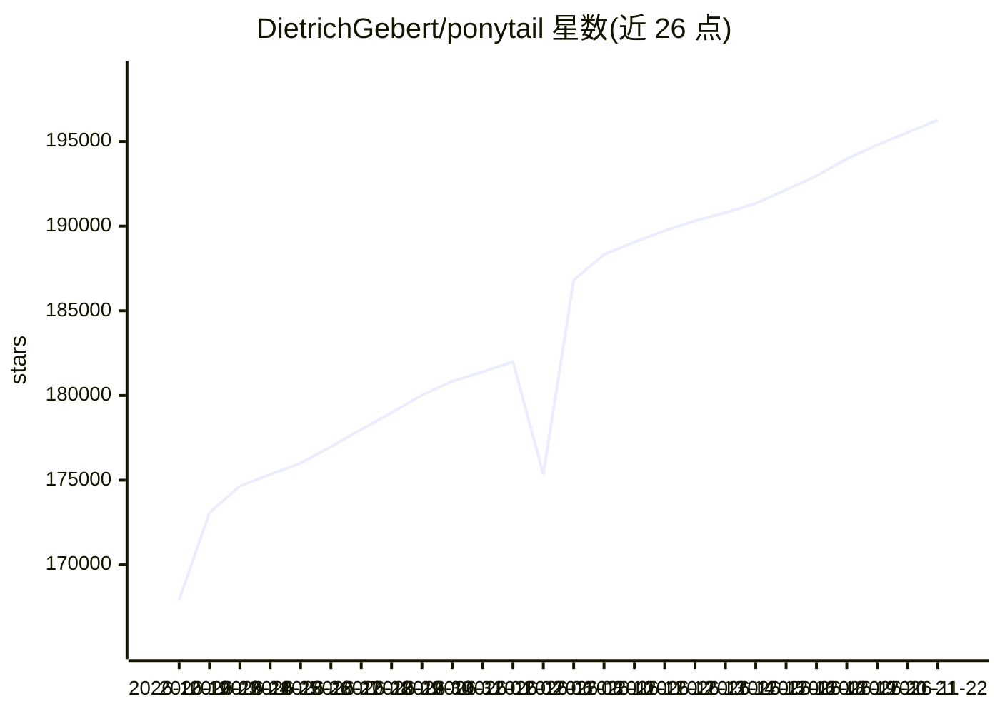

# DietrichGebert/ponytail

⭐ 196,267 · JavaScript · MIT · 推送 2026-10-29 · [GitHub](https://github.com/DietrichGebert/ponytail) · [官网](https://ponytail.dev) · 个人维护 · 中文 README

**给编码 AI agent 注入「最懒资深开发」约束的提示词技能包**

以单一提示词（SKILL.md/AGENTS.md）为核心的 agent 技能包：让编码 agent 写代码前先按七级阶梯（是否需要写、复用代码库、标准库、平台特性、已有依赖、一行实现）选择最小方案，并在回复中声明跳过项与风险。提供 /ponytail-review 读取改动触及的代码做审查、/ponytail-audit 全仓库问题排序、/ponytail-debt 收集 shortcut 注释等功能；Claude Code 中还提供显示成本/令牌/复用率的状态条与本地看板页。安装方式为 Claude Code/Codex 插件市场，或其他 agent 复制规则文件；命令功能需支持 skill 的宿主。

## 筛选速览

| 维度 | 判定 | 备注 |
|---|---|---|
| AI 角色 | `ai-ecosystem` | LLM/agent 周边工具 |
| 许可风险 | `permissive` | MIT |
| 部署形态 | `desktop` | 安装包/桌面程序 |
| 模型依赖 | — | README 未给出锁定关系 |
| 硬件要求 | — | 无带数字的原话,不猜 |
| 安装摩擦 | `low` | 无编译、无系统依赖或容器化 |
| 成熟度 | — | 结构信号不足 |

## 动量与使用信号

- 维护:`active` — 距上次 push 1.3 天,年发版 29,128 位贡献者
- 涨星:近 1 天 **+1,217**(自 20261016 起算)
- 安装:github 包 `release-assets` 月下载无数据

## 能力要点

- 单一提示词技能（SKILL.md/AGENTS.md）加载进多种 agent
- 七级复用阶梯决定是否写新代码，强调保留验证/安全/可访问性
- /ponytail-review 审查 diff 触及的完整代码而非仅 diff
- Claude Code 状态条与本地看板统计成本、令牌、agent 时间

## 适用场景

- 让编码 agent 优先复用仓库现有组件而非重复造轮子
- 对当前 diff 或整个仓库做风险与安全问题审查
- 统计 AI 编码任务的成本、令牌与复用率
- 在 Copilot/Cursor/Windsurf 等工具中加载统一规则文件

## 场景标签

`提示工程` `编码 Agent` `代码审查` · 领域:Agent 开发

## 证据(README 行号)

> L101: Ponytail is one prompt: `skills/ponytail/SKILL.md`. The compact version, for agents that read a rules file, is `AG
> L123: **Any other agent:** copy `AGENTS.md` into your project, or ask your agent to install `skills/ponytail/SKILL.md` a

## 星数曲线

2026-10-19 167,924 → 2026-11-22 196,267（+28,343）

---
*卡片 v1 · prompt 1.4 · 生成 2026-11-22 · 置信度 high · 依据 README sha `d19a4a35c9bc` · [字段定义](../../DATASET.md)*
