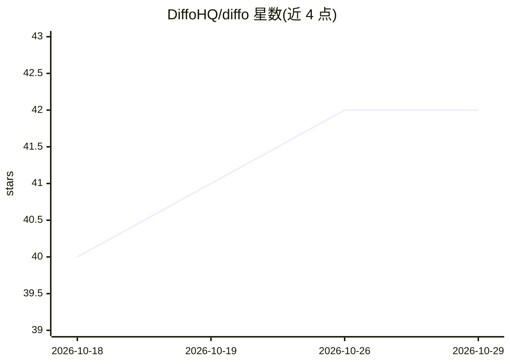

# DiffoHQ/diffo

⭐ 42 · TypeScript · Apache-2.0 · 推送 2026-10-28 · [GitHub](https://github.com/DiffoHQ/diffo) · [官网](https://diffo.io) · 组织维护

**本地运行的代码审查工具：阅读 agent 代码并让 agent 在行内回应**

面向使用 AI 编码 agent 的开发者的本地代码审查工具：以分层顺序呈现 diff，允许在任何一行提问，由已接入的 agent（通过 diffo CLI 保持连接）在行内回答、解释并直接修复；也可签出 GitHub PR 到独立 worktree，读完将审查意见提交回 GitHub。单进程绑定 loopback 运行，无账号、无云端、无模型 API，自己不生成 agent。通过 npx skills 安装，需 Node>=24 与 git；PR 审查需 GitHub CLI 登录。核心 Apache-2.0，计划推出付费托管团队版。

## 筛选速览

| 维度 | 判定 | 备注 |
|---|---|---|
| AI 角色 | `ai-ecosystem` | LLM/agent 周边工具 |
| 许可风险 | `permissive` | Apache-2.0 |
| 部署形态 | `library` | 以包/库形式分发 |
| 模型依赖 | — | README 未给出锁定关系 |
| 硬件要求 | — | 无带数字的原话,不猜 |
| 安装摩擦 | `low` | 无编译、无系统依赖或容器化 |
| 成熟度 | — | 结构信号不足 |

## 能力要点

- diff 按阅读顺序分层展示，每层含标题、摘要与文件
- 行内提问由写代码的 agent 回答并直接落修复到当前 diff
- GitHub PR 独立 worktree 签出，审查完成后提交回 GitHub
- 本地单进程、绑定 loopback，不调用模型 API，遥测可一条命令关闭

## 适用场景

- 审查 AI agent 刚写的代码并在行内继续对话让它修
- 以分层阅读顺序审查多文件改动
- 在本地审查他人 PR，私下问 agent、正式评论发 GitHub

## 场景标签

`代码审查` · 领域:编码与开发

## 证据(README 行号)

> L8: read, and **the agent on the other end of every comment**: it answers on the line and fixes
> L110: One process on your machine, bound to loopback: no account, no cloud, and no model API.
> L113: of its own; the one you're already talking to stays attached through the `diffo` CLI, so

## 星数曲线

2026-10-18 40 → 2026-10-29 42（+2）

---
*卡片 v1 · prompt 1.4 · 生成 2026-10-25 · 置信度 high · 依据 README sha `4242747caaac` · [字段定义](../../DATASET.md)*
