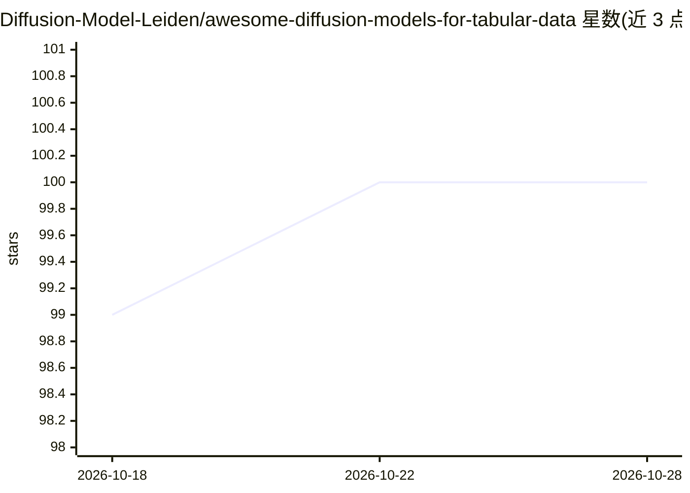

# Diffusion-Model-Leiden/awesome-diffusion-models-for-tabular-data

⭐ 100 · NOASSERTION · 推送 2026-05-29 · [GitHub](https://github.com/Diffusion-Model-Leiden/awesome-diffusion-models-for-tabular-data) · 组织维护

**表格数据扩散与流匹配模型研究的策展清单**

作为综述论文 'Diffusion and Flow Matching Models for Tabular Data: A Survey'（在审）的官方仓库，按数据增强、数据填补、可信数据合成、记忆化缓解、异常检测等类别收录表格数据扩散与流匹配模型的研究论文条目，每条含会议/年份、代码可用性与领域标注；另含 GenAI for Tabular Data 时间线、分类体系及离散数据处理的深入章节。通过 issue 模板接受社区推荐论文，许可为 CC BY 4.0。

## 筛选速览

| 维度 | 判定 | 备注 |
|---|---|---|
| AI 角色 | `ai-knowledge` | 知识聚合/清单类 |
| 许可风险 | `none` | NOASSERTION |
| 部署形态 | `None` |  |
| 模型依赖 | — | README 未给出锁定关系 |
| 硬件要求 | — | 无带数字的原话,不猜 |
| 安装摩擦 | `low` | 无编译、无系统依赖或容器化 |
| 成熟度 | — | 结构信号不足 |

## 能力要点

- 按 5 类应用（数据增强/填补/可信合成/记忆化缓解/异常检测）组织论文条目
- 覆盖单表与多关系数据合成、扩散与流匹配两条技术路线
- 条目标注会议年份、代码可用性与领域（Generic/Healthcare/Finance）

## 适用场景

- 查找表格数据合成/填补/异常检测的扩散模型论文与代码
- 了解该领域分类体系与研究时间线
- 为综述写作或选型收集基线方法

## 场景标签

`精选清单` · 领域:学习与行业

## 证据(README 行号)

> L7: We explore recent advancements in **diffusion and flow matching models for tabular data** and highlight key challeng
> L10: 👉 Diffusion and Flow Matching Models for Tabular Data: A Survey (under review)
> L42: Research on generative models for tabular data is primarily motivated by real-world applications. Based on their us

## 星数曲线

2026-10-18 99 → 2026-10-28 100（+1）

---
*卡片 v1 · prompt 1.4 · 生成 2026-10-23 · 置信度 high · 依据 README sha `917e3306a39e` · [字段定义](../../DATASET.md)*
