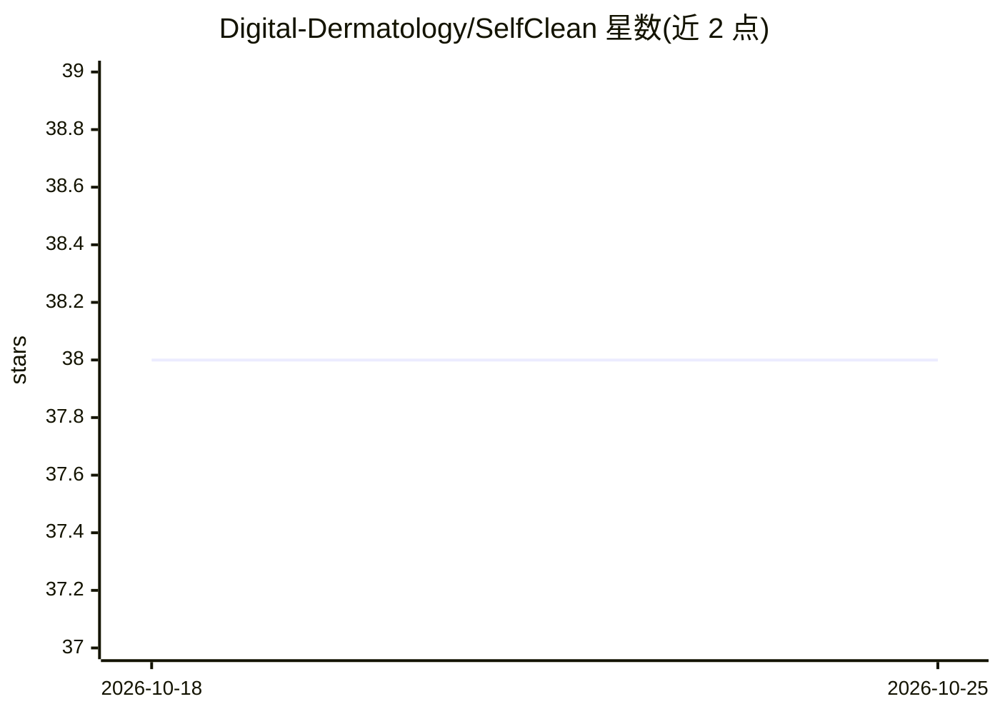

# Digital-Dermatology/SelfClean

⭐ 38 · Python · NOASSERTION · 推送 2026-04-28 · [GitHub](https://github.com/Digital-Dermatology/SelfClean) · [官网](https://selfclean.github.io/) · 组织维护

**自监督数据清洗库：检测离题样本、近重复与标签错误**

NeurIPS 2024 论文配套的 Python 库，用自监督学习方法对图像数据集做整体质量审计，检测离题/off-topic 样本、近重复样本与标签错误。以 PyPI 包形式提供，几行代码即可在自定义数据集上运行，附 Imagenette、Oxford-IIIT Pet 等示例 notebook 与 Kaggle 竞赛数据清洗示例；仓库内置预训练模型，拉取前需安装 git-lfs。许可证为 CC BY-NC 4.0（非商业）。

## 筛选速览

| 维度 | 判定 | 备注 |
|---|---|---|
| AI 角色 | `ai-native` | 本体是模型或模型工具 |
| 许可风险 | `none` | NOASSERTION |
| 部署形态 | `library` | 以包/库形式分发 |
| 模型依赖 | — | README 未给出锁定关系 |
| 硬件要求 | — | 无带数字的原话,不猜 |
| 安装摩擦 | `medium` | 含编译或系统依赖之一 |
| 成熟度 | — | 结构信号不足 |

## 能力要点

- 自监督方式检测离题样本、近重复与标签错误
- 预训练模型开箱即用，几行代码即可在自定义数据集运行
- 提供示例 notebook（Imagenette、Oxford-IIIT Pet）与 Kaggle 清洗示例

## 适用场景

- 训练前清洗图像数据集，剔除离题与重复样本
- 审计基准数据集的标签错误与污染
- 竞赛数据集质量提升与结果核验

## 场景标签

`MLOps` · 领域:训练与推理

## 证据(README 行号)

> L7: A holistic self-supervised data cleaning strategy to detect off-topic samples, near duplicates, and label errors.
> L9: **Publications:** SelfClean Paper (NeurIPS24) | Data Cleaning Protocol Paper (ML4H23@NeurIPS)

## 星数曲线

2026-10-18 38 → 2026-10-25 38（+0）

---
*卡片 v1 · prompt 1.4 · 生成 2026-10-25 · 置信度 high · 依据 README sha `0523a100fa2f` · [字段定义](../../DATASET.md)*
