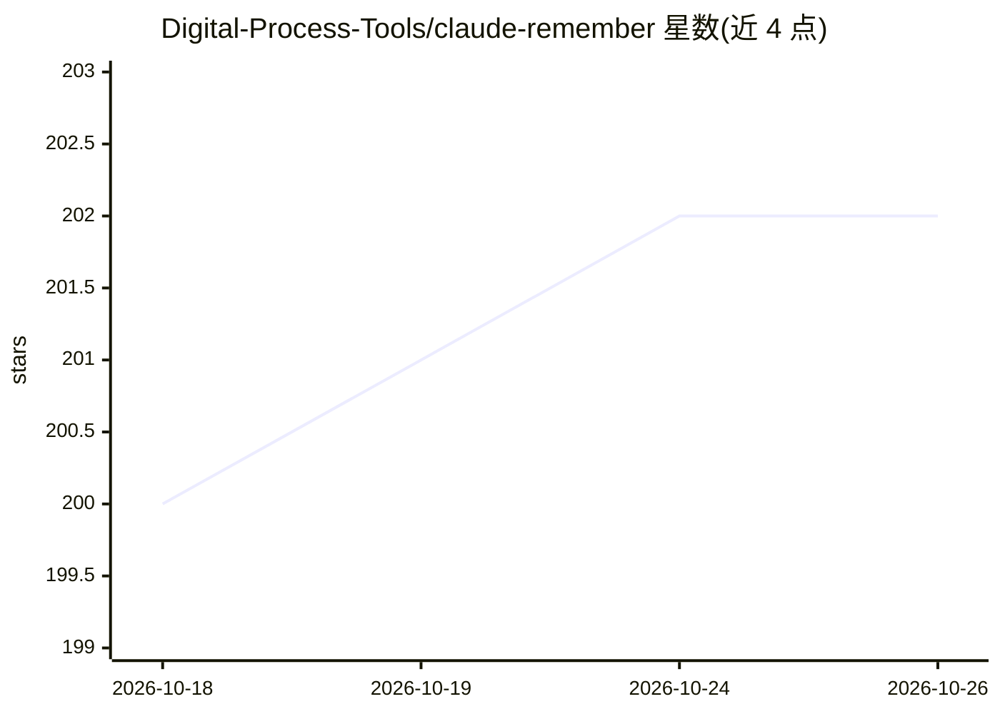

# Digital-Process-Tools/claude-remember

⭐ 202 · Python · NOASSERTION · 推送 2026-10-25 · [GitHub](https://github.com/Digital-Process-Tools/claude-remember) · 组织维护

**为 Claude Code 等 CLI 编码代理提供跨会话持久记忆的插件**

面向编码代理（Claude Code、Codex、Antigravity CLI）的记忆插件：通过钩子接入代理生命周期，自动保存会话，经 Claude Haiku 压缩为分层的每日/每周摘要，并在下次会话启动时注入身份、交接笔记与近期历史等上下文文件，替代手动重述背景。摘要通过调用用户已登录的 claude/codex CLI 完成，典型单次保存成本低于 $0.01，每日运行成本几美分；记忆默认本地存储于 .remember/ 目录，可选 git 备份。提供 /remember 交接命令与 /remember:doctor 诊断命令。

## 筛选速览

| 维度 | 判定 | 备注 |
|---|---|---|
| AI 角色 | `ai-ecosystem` | LLM/agent 周边工具 |
| 许可风险 | `none` | NOASSERTION |
| 部署形态 | `None` |  |
| 模型依赖 | locked-api |  |
| 硬件要求 | — | 无带数字的原话,不猜 |
| 安装摩擦 | `low` | 无编译、无系统依赖或容器化 |
| 成熟度 | — | 结构信号不足 |

## 能力要点

- SessionStart 钩子自动注入 identity/remember/today/recent/archive 等分层记忆文件
- 经 Haiku 压缩的分层摘要：原始交换→单行摘要→周段落
- 支持 Claude Code、Codex、Antigravity CLI 三种宿主，含各自安装脚本
- 摘要调用嵌套 claude -p / codex exec，以无工具/只读沙箱方式运行

## 适用场景

- 让编码代理跨会话记住项目约定、已踩过的坑和昨天的工作
- 结束会话前用 /remember 写交接笔记，下个会话自动加载
- 为团队编码代理维护持续的项目身份与历史上下文

## 场景标签

`Agent 记忆` · 领域:Agent 开发

## 证据(README 行号)

> L18: Claude Remember fixes that. It hooks into your coding agent's lifecycle — saving sessions automatically, compressin
> L33: On session start, the `SessionStart` hook automatically injects into your coding agent's context:

## 星数曲线

2026-10-18 200 → 2026-10-26 202（+2）

---
*卡片 v1 · prompt 1.4 · 生成 2026-10-22 · 置信度 high · 依据 README sha `26ded6d6ef1e` · [字段定义](../../DATASET.md)*
