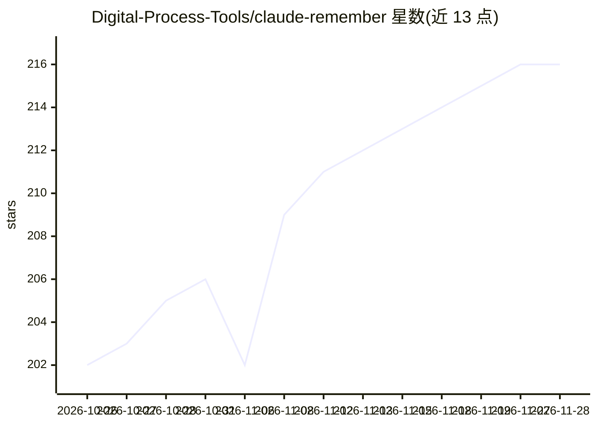

# Digital-Process-Tools/claude-remember

⭐ 216 · Python · NOASSERTION · 推送 2026-11-27 · [GitHub](https://github.com/Digital-Process-Tools/claude-remember) · 组织维护

**给编码 agent 的跨会话持久记忆插件：自动保存、压缩并回载历史**

以 Claude Code/Codex/Antigravity 插件形式运行的记忆层：通过生命周期钩子在会话结束时自动保存记录，用 Haiku 逐层压缩为当日摘要、7 日汇总与归档，并在下次会话启动时自动注入 identity/remember/now 等记忆文件。支持 /remember 交接与 /remember:doctor 诊断命令，数据默认存于项目内 .remember/ 目录，可切换外部存储与 git 备份。需 Python 3.9+、jq、Bash 与带 Haiku 访问的 Claude CLI；Windows 需 POSIX shell，多数测试在该平台跳过。

## 筛选速览

| 维度 | 判定 | 备注 |
|---|---|---|
| AI 角色 | `ai-ecosystem` | LLM/agent 周边工具 |
| 许可风险 | `none` | NOASSERTION |
| 部署形态 | `None` |  |
| 模型依赖 | locked-api |  |
| 硬件要求 | — | 无带数字的原话,不猜 |
| 安装摩擦 | `low` | 无编译、无系统依赖或容器化 |
| 成熟度 | — | 结构信号不足 |

## 能力要点

- SessionStart 钩子自动注入分层记忆文件，无需手动提示
- Haiku 分层压缩：raw→单行→日摘要→周段落，单次保存成本 <$0.01
- 支持 Claude Code、Codex、Antigravity CLI 三种宿主安装
- REMEMBER_SUMMARIZER 可选 claude/codex 嵌套 CLI 做摘要

## 适用场景

- 让编码 agent 记住昨天的进度、团队约定与踩过的坑
- 长会话清空前用 /remember 写交接笔记给下一会话
- 记忆未生效时用 /remember:doctor 排查钩子触发情况

## 场景标签

`Agent 记忆` · 领域:Agent 开发

## 证据(README 行号)

> L18: Claude Remember fixes that. It hooks into your coding agent's lifecycle — saving sessions automatically, compressin
> L61: **Claude Code**
> L91: - Python 3.9+

## 星数曲线

2026-10-26 202 → 2026-11-28 216（+14）

---
*卡片 v1 · prompt 1.4 · 生成 2026-11-28 · 置信度 high · 依据 README sha `9ca57f305465` · [字段定义](../../DATASET.md)*
