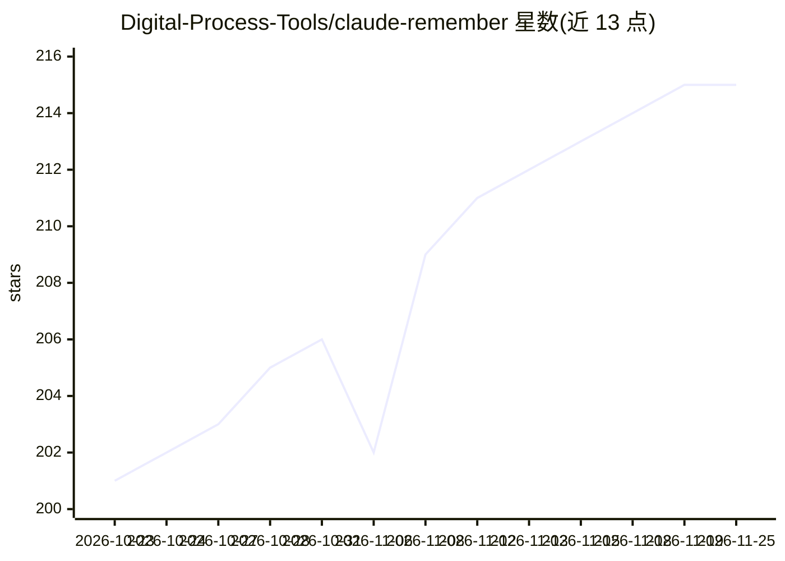

# Digital-Process-Tools/claude-remember

⭐ 215 · Python · NOASSERTION · 推送 2026-11-23 · [GitHub](https://github.com/Digital-Process-Tools/claude-remember) · 组织维护

**给编码 Agent 提供跨会话持久记忆的插件**

以 Claude Code/Codex/Antigravity 插件形式运行的记忆层：通过生命周期钩子在会话结束/工具调用后自动保存会话，经 Haiku 压缩为今日/近 7 天/归档等多层摘要文件，下次会话启动时自动注入上下文。支持 /remember 手工交接、/remember:doctor 诊断、外部存储模式与 git 备份。依赖 Python 3.9+、Bash、jq，Windows 需 POSIX shell，压缩调用按 Anthropic API 计费（每日约几美分）。

## 筛选速览

| 维度 | 判定 | 备注 |
|---|---|---|
| AI 角色 | `ai-ecosystem` | LLM/agent 周边工具 |
| 许可风险 | `none` | NOASSERTION |
| 部署形态 | `None` |  |
| 模型依赖 | — | README 未给出锁定关系 |
| 硬件要求 | — | 无带数字的原话,不猜 |
| 安装摩擦 | `low` | 无编译、无系统依赖或容器化 |
| 成熟度 | — | 结构信号不足 |

## 能力要点

- SessionStart 钩子自动注入 identity/remember/now/today/recent/archive 等分层记忆文件
- 经 Haiku 将原始会话逐层压缩为日/周/归档摘要，控制 token 占用
- 同时适配 Claude Code、Codex CLI 与 Antigravity 三种宿主
- REMEMBER_SUMMARIZER 可选择 claude/codex/auto 摘要路由并带沙箱参数

## 适用场景

- 让编码 Agent 记住昨天的进展、项目约定与踩过的坑
- 团队协作中让 Agent 延续代码规范与上下文
- 手工结束会话前用 /remember 写交接笔记
- 诊断钩子未生效或记忆文件缺失的问题

## 场景标签

`编码 Agent` `Agent 记忆` · 领域:Agent 开发

## 证据(README 行号)

> L18: Claude Remember fixes that. It hooks into your coding agent's lifecycle — saving sessions automatically, compressin
> L61: **Claude Code**
> L92: - Claude CLI (`claude`) with Haiku access

## 星数曲线

2026-10-23 201 → 2026-11-25 215（+14）

---
*卡片 v1 · prompt 1.4 · 生成 2026-11-25 · 置信度 high · 依据 README sha `8af3545389ff` · [字段定义](../../DATASET.md)*
