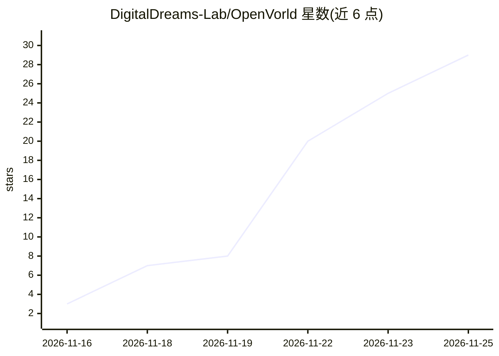

# DigitalDreams-Lab/OpenVorld

⭐ 29 · JavaScript · MIT · 推送 2026-11-20 · [GitHub](https://github.com/DigitalDreams-Lab/OpenVorld) · [官网](https://openvorld.com) · 组织维护

**给 AI agent 团队一个像素风 RPG 世界看板的本地优先工作台**

OpenVorld 将 AI agent 协作过程可视化为像素 RPG 世界：每个项目是一个 vorld，包含命名成员的 crew、共享项目文件夹与需用户批准的权限（writ）。成员可组队（party）共享会话、@mentions 交接工作，产出 XP/等级记录。通过接入 Claude Code、Codex 或 OpenAI 兼容 API 驱动成员，数据以 YAML/JSON/JSONL 本地存储，无托管后端与账号。需要 Node.js 20+，提供桌面 shell 与浏览器运行方式。

## 筛选速览

| 维度 | 判定 | 备注 |
|---|---|---|
| AI 角色 | `ai-ecosystem` | LLM/agent 周边工具 |
| 许可风险 | `permissive` | MIT |
| 部署形态 | `desktop` | 安装包/桌面程序 |
| 模型依赖 | local-ok | 支持本地模型 |
| 硬件要求 | — | 无带数字的原话,不猜 |
| 安装摩擦 | `low` | 无编译、无系统依赖或容器化 |
| 成熟度 | `idea` | |

## 能力要点

- crew/party/writ 机制：agent 成员有名字、角色、工位，访问需用户批准
- 兼容 Claude Code、Codex 及 OpenAI 兼容 API（OpenRouter/Ollama/LM Studio），每个成员可用不同 provider
- 数据以 YAML/JSON/JSONL 全本地存储，无账号与托管后端
- Packs 扩展模板、角色、主题与 provider 设置

## 适用场景

- 用一个界面观察多个 agent 在软件项目中的分工与工具调用
- 需要逐项批准 agent 的文件夹/命令/网站访问权限
- 为内容工作室或小型团队搭建 agent 协作场景

## 场景标签

`多智能体` `Agent 框架` · 领域:Agent 开发

## 证据(README 行号)

> L6:  An open-source harness for your AI agents, shown as a living RPG world: your projects, your crew, and the work you 
> L47: Use installed agent tools such as **Claude Code** or **Codex**, or connect an **OpenAI-compatible API** such as Ope

## 星数曲线

2026-11-16 3 → 2026-11-25 29（+26）

---
*卡片 v1 · prompt 1.4 · 生成 2026-11-20 · 置信度 high · 依据 README sha `8f7323e5ba6b` · [字段定义](../../DATASET.md)*
