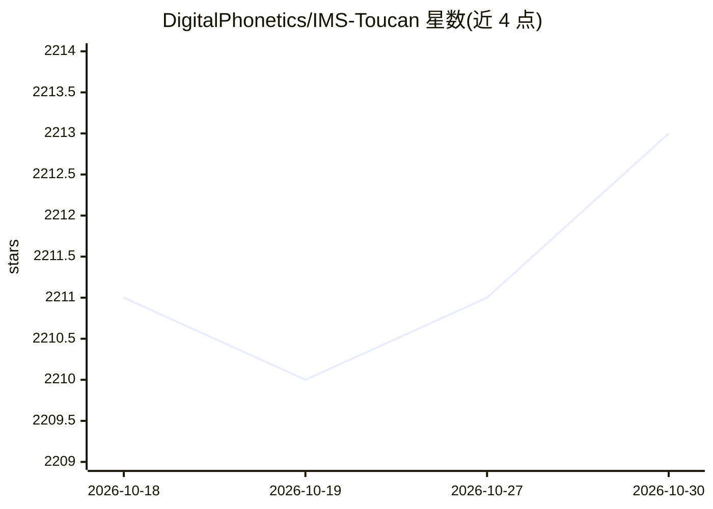

# DigitalPhonetics/IMS-Toucan

⭐ 2,213 · Python · Apache-2.0 · 推送 2026-01-25 · [GitHub](https://github.com/DigitalPhonetics/IMS-Toucan) · 组织维护

**覆盖7000+语言的文本转语音（TTS）工具包，支持训练与推理**

斯图加特大学 IMS 自然语言处理研究所开发的 ToucanTTS 系统官方工具包，用于训练、使用和教学多语言文本转语音合成。提供预训练模型（经 Hugging Face 自动下载）、InferenceInterface 两种合成方式（read_to_file 写文件、read_aloud 直接播放），可调节时长、音高与能量方差。训练侧通过编写 recipe 流水线，用 run_training_pipeline.py 启动，支持单/多 GPU（torchrun 分布式）。推理无需 GPU；训练需 CUDA GPU。Linux 需安装 libsndfile1、ffmpeg 等系统包，eSpeak-NG 为可选依赖。

## 筛选速览

| 维度 | 判定 | 备注 |
|---|---|---|
| AI 角色 | `ai-native` | 本体是模型或模型工具 |
| 许可风险 | `permissive` | Apache-2.0 |
| 部署形态 | `desktop` | 安装包/桌面程序 |
| 模型依赖 | — | README 未给出锁定关系 |
| 硬件要求 | — | 无带数字的原话,不猜 |
| 安装摩擦 | `medium` | 含编译或系统依赖之一 |
| 成熟度 | — | 结构信号不足 |

## 能力要点

- 支持 7000+ 语言的 ToucanTTS 官方实现
- 预训练模型经 Hugging Face 按需自动下载
- 推理无需 GPU，训练支持单/多 GPU 分布式（torchrun）
- 时长/音高/能量方差的缩放控制参数，及数据集异常样本打分器

## 适用场景

- 用预训练模型直接把文本合成为多语言语音
- 在自己的数据集上微调或从头训练 TTS 模型
- 作为 TTS 研究与教学的实验工具

## 场景标签

`语音合成` `模型训练` · 领域:内容生成

## 证据(README 行号)

> L8: IMS Toucan is a toolkit for training, using, and teaching state-of-the-art Text-to-Speech Synthesis, developed at th
> L133: An *InferenceInterface* contains two methods to create audio from text. They are

## 星数曲线

2026-10-18 2,211 → 2026-10-30 2,213（+2）

---
*卡片 v1 · prompt 1.4 · 生成 2026-10-21 · 置信度 mid · 依据 README sha `49f2241e9701` · [字段定义](../../DATASET.md)*
