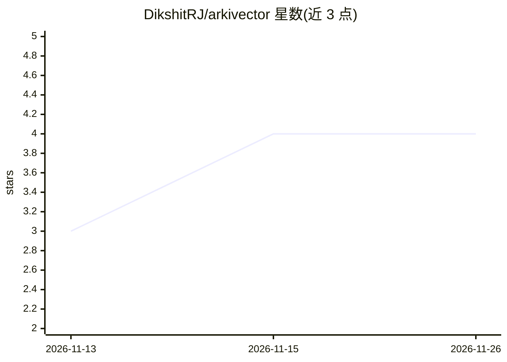

# DikshitRJ/arkivector

⭐ 4 · C · MIT · 推送 2026-11-13 · [GitHub](https://github.com/DikshitRJ/arkivector) · [官网](https://arkivector.dikshitrj.in) · 个人维护

**在 Arkiv 区块链上做向量检索的 pgvector 式引擎**

为 Arkiv 链上数据提供语义检索的守护进程与 SDK：复用 pgvector 源码的距离算子与 HNSW 索引，向量以普通 Arkiv 实体形式写入链上，守护进程同步区块、维护本地 LMDB/段文件索引并经 REST 暴露搜索。提供 Python 与 Node.js SDK、Qdrant 兼容的搜索子集及 MCP 服务器（供 agent 存取记忆）。读操作无需钱包，写操作需要已注资的 EVM 钱包签名交易并支付 gas。

## 筛选速览

| 维度 | 判定 | 备注 |
|---|---|---|
| AI 角色 | `ai-ecosystem` | LLM/agent 周边工具 |
| 许可风险 | `permissive` | MIT |
| 部署形态 | `desktop` | 安装包/桌面程序 |
| 模型依赖 | — | README 未给出锁定关系 |
| 硬件要求 | — | 无带数字的原话,不猜 |
| 安装摩擦 | `low` | 无编译、无系统依赖或容器化 |
| 成熟度 | — | 结构信号不足 |

## 能力要点

- 支持全部四种 pgvector 向量类型与六个距离算子，含 HNSW 索引与精确扫描回退
- 写入上链：守护进程构建、签名并提交 Arkiv 交易，读取链后回执才索引
- 内置 MCP 服务器，AI agent 可搜索集合并链上存取记忆
- 提供 Qdrant 兼容搜索子集与 Python/Node.js SDK

## 适用场景

- 为 RAG 管线在去中心化链上存放并检索向量数据
- 让 AI agent 通过 MCP 把记忆存储在链上并可搜索
- 在 Arkiv 实体上做带属性过滤的相似度检索

## 场景标签

`向量数据库` `RAG` `Agent 记忆` · 领域:Agent 开发

## 证据(README 行号)

> L4: **pgvector for Arkiv.** Semantic search over data that lives on a decentralized chain, with pgvector's own distance 
> L57: - SDKs for Python and Node.js, an MCP server so AI agents can search and store memories, and a Qdrant-compatible se
> L158: The daemon is also a Model Context Protocol server at `POST /mcp`, so agents can search your collections, read ent

## 星数曲线

2026-11-13 3 → 2026-11-26 4（+1）

---
*卡片 v1 · prompt 1.4 · 生成 2026-11-21 · 置信度 high · 依据 README sha `e5fd5219861b` · [字段定义](../../DATASET.md)*
