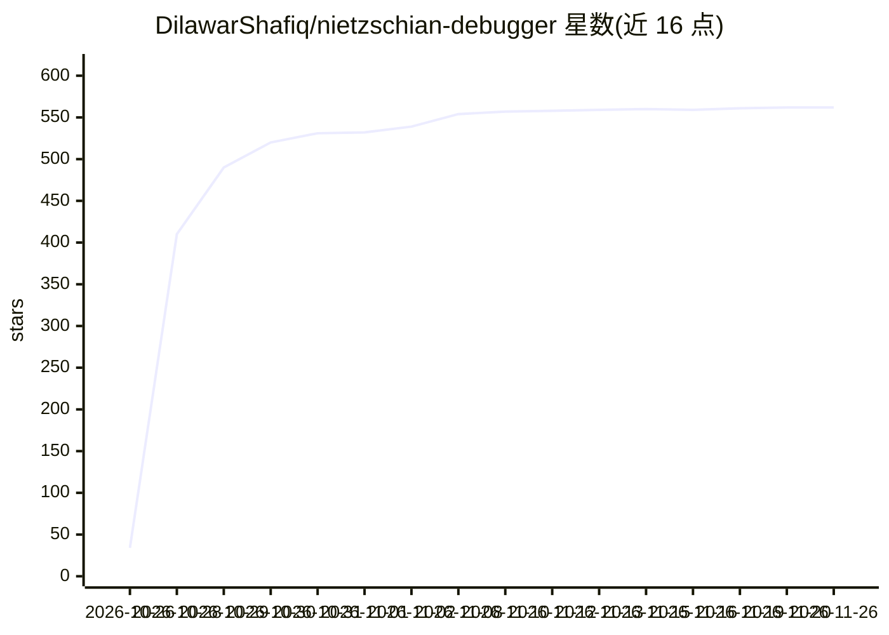

# DilawarShafiq/nietzschian-debugger

⭐ 562 · Python · MIT · 推送 2026-11-24 · [GitHub](https://github.com/DilawarShafiq/nietzschian-debugger) · [官网](https://pypi.org/project/nietzschian-debugger/) · 个人维护

**给开发者的苏格拉底式调试 CLI：只提问不给答案**

一个 Python CLI 工具，用户粘贴 bug 后它不直接给修复方案，而是通过三种可切换的"镜片"（socrates/nietzsche/zarathustra）以提问方式引导开发者自行找到根因；内置 model-judge 校验器防止模型泄露答案。支持 debug/predict/roast 三个命令，predict 会实际运行用户代码验证猜测。默认走 Anthropic API，也可通过 OpenAI 兼容接口接入其他托管或本地模型。MIT 许可，需 Python >= 3.10 与模型 API key（本地 Ollama 可免 key）。

## 筛选速览

| 维度 | 判定 | 备注 |
|---|---|---|
| AI 角色 | `ai-native` | 本体是模型或模型工具 |
| 许可风险 | `permissive` | MIT |
| 部署形态 | `library` | 以包/库形式分发 |
| 模型依赖 | local-ok | 支持本地模型 |
| 硬件要求 | — | 无带数字的原话,不猜 |
| 安装摩擦 | `low` | 无编译、无系统依赖或容器化 |
| 成熟度 | — | 结构信号不足 |

## 能力要点

- 所有回复均为提问，内置 model-judge 校验器防止泄露答案
- predict 命令实际运行用户代码给出真实返回值而非模型猜测
- 三种自适应教学镜片：socrates/nietzsche/zarathustra，按轮次切换
- 支持 Claude、OpenAI 系托管模型及本地 Ollama/LM Studio 模型

## 适用场景

- 开发者想通过调试过程训练自己的排障能力而非直接要答案
- 团队新人培养批判性思维，避免复制粘贴式开发
- 用 roast 命令快速获得对遗留代码的犀利点评
- 用 predict 检验自己对自己代码行为的真实理解

## 场景标签

 · 领域:开发者工具/教育

## 证据(README 行号)

> L11: **It won't fix your bug. It'll fix you.** Every other tool hands you the answer; Nietzschian Debugger hands the que
> L13: You paste your bug. It doesn't fix it. Instead, it:
> L69: **Claude is the default and the sharpest experience.** With `ANTHROPIC_API_KEY` set,

## 星数曲线

2026-10-26 34 → 2026-11-26 562（+528）

---
*卡片 v1 · prompt 1.4 · 生成 2026-11-25 · 置信度 mid · 依据 README sha `4ee53987c191` · [字段定义](../../DATASET.md)*
