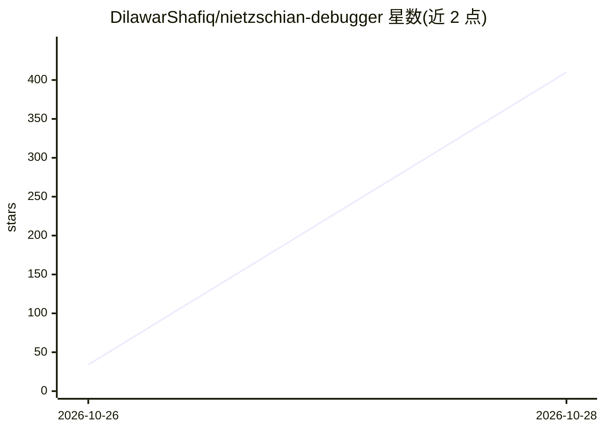

# DilawarShafiq/nietzschian-debugger

⭐ 410 · Python · MIT · 推送 2026-10-27 · [GitHub](https://github.com/DilawarShafiq/nietzschian-debugger) · [官网](https://pypi.org/project/nietzschian-debugger/) · 个人维护

**只提问不给答案的 CLI 调试教练，逼开发者自己找到 bug**

终端对话式调试辅导工具：用户粘贴 bug 描述，工具不给出修复方案，而是持续生成追问以挑战假设、暴露被回避的证据，直到用户自己定位根因。三档强度（socrates/nietzsche/zarathustra）适配不同水平，可读取用户指定路径的真实代码，提供成长分数图表与会话本地历史（.nietzschian/sessions/）。基于 Python 3.10+ 与 Claude API（Anthropic SDK，需自带 API key），npm 发布版需 Node.js >= 20，附长会话滑窗摘要机制。

## 筛选速览

| 维度 | 判定 | 备注 |
|---|---|---|
| AI 角色 | `ai-native` | 本体是模型或模型工具 |
| 许可风险 | `permissive` | MIT |
| 部署形态 | `library` | 以包/库形式分发 |
| 模型依赖 | locked-api |  |
| 硬件要求 | — | 无带数字的原话,不猜 |
| 安装摩擦 | `low` | 无编译、无系统依赖或容器化 |
| 成熟度 | — | 结构信号不足 |

## 能力要点

- 每个回复均为问题，工具声明绝不给出修复答案
- 三档强度：socrates/nietzsche（默认）/zarathustra
- 可读取用户指定文件路径的真实代码
- 成长分数条形图与会话本地保存与趋势追踪

## 适用场景

- 我想靠自己推理找到 bug，只要工具逼我问对问题
-  junior 成员借引导式提问建立调试直觉
- 长调试会话中保留上下文并追踪自己进步

## 场景标签

`AI 助手` · 领域:对话与助手

## 证据(README 行号)

> L85: - **Never Gives Answers** — Every response is a question. The tool will NEVER tell you the fix.
> L122: - Claude API via the Anthropic SDK

## 星数曲线

2026-10-26 34 → 2026-10-28 410（+376）

---
*卡片 v1 · prompt 1.4 · 生成 2026-10-27 · 置信度 high · 依据 README sha `6cbe661b4a73` · [字段定义](../../DATASET.md)*
