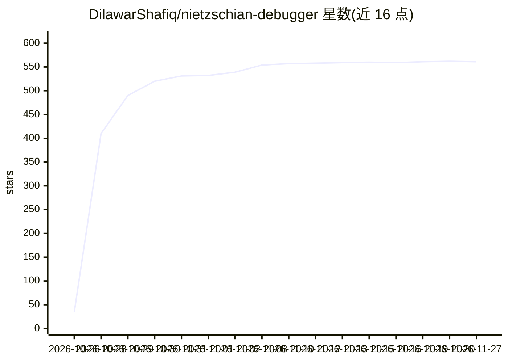

# DilawarShafiq/nietzschian-debugger

⭐ 561 · Python · MIT · 推送 2026-11-24 · [GitHub](https://github.com/DilawarShafiq/nietzschian-debugger) · [官网](https://pypi.org/project/nietzschian-debugger/) · 个人维护

**给开发者的苏格拉底式调试 CLI：只提问不给答案**

一个 Python CLI 调试工具：用户粘贴 bug 后不直接给出修复，而是通过提问挑战假设、引导用户自行找到修复。核心机制是单问题规则加模型判卷校验器防止泄露答案，并提供三镜头自适应（socrates/nietzsche/zarathustra）、predict 运行代码验证理解、roast 代码点评、会话导出与成长评分。依赖 Python ≥3.10 与一个模型后端（Anthropic key 或其他兼容模型）。

## 筛选速览

| 维度 | 判定 | 备注 |
|---|---|---|
| AI 角色 | `ai-native` | 本体是模型或模型工具 |
| 许可风险 | `permissive` | MIT |
| 部署形态 | `library` | 以包/库形式分发 |
| 模型依赖 | local-ok | 支持本地模型 |
| 硬件要求 | — | 无带数字的原话,不猜 |
| 安装摩擦 | `low` | 无编译、无系统依赖或容器化 |
| 成熟度 | — | 结构信号不足 |

## 能力要点

- 每个回复都是问题，模型判卷校验器拦截泄露答案的回复
- predict 命令实际运行用户代码给出返回值真相
- 三镜头自适应切换：socrates/nietzsche/zarathustra
- 支持 Claude 默认及 OpenAI 兼容端点、本地 Ollama/LM Studio 模型

## 适用场景

- 想让 AI 引导自己找 bug 根因而非直接抄答案
- 训练团队或自己保持调试时的批判性思考
- 检验对某段代码行为的真实理解（predict）
- 对遗留文件做快速吐槽式点评（roast）

## 场景标签

`AI 助手` `代码审查` · 领域:编码与开发

## 证据(README 行号)

> L12: **It won't fix your bug. It'll fix you.** Every other tool hands you the answer; Nietzschian Debugger hands the que
> L254: - **Refuses to Hand You the Fix** — Every response is a question. It's built to withhold the answer, and a model-j

## 星数曲线

2026-10-26 34 → 2026-11-27 561（+527）

---
*卡片 v1 · prompt 1.4 · 生成 2026-11-26 · 置信度 mid · 依据 README sha `e582cb6a9f31` · [字段定义](../../DATASET.md)*
