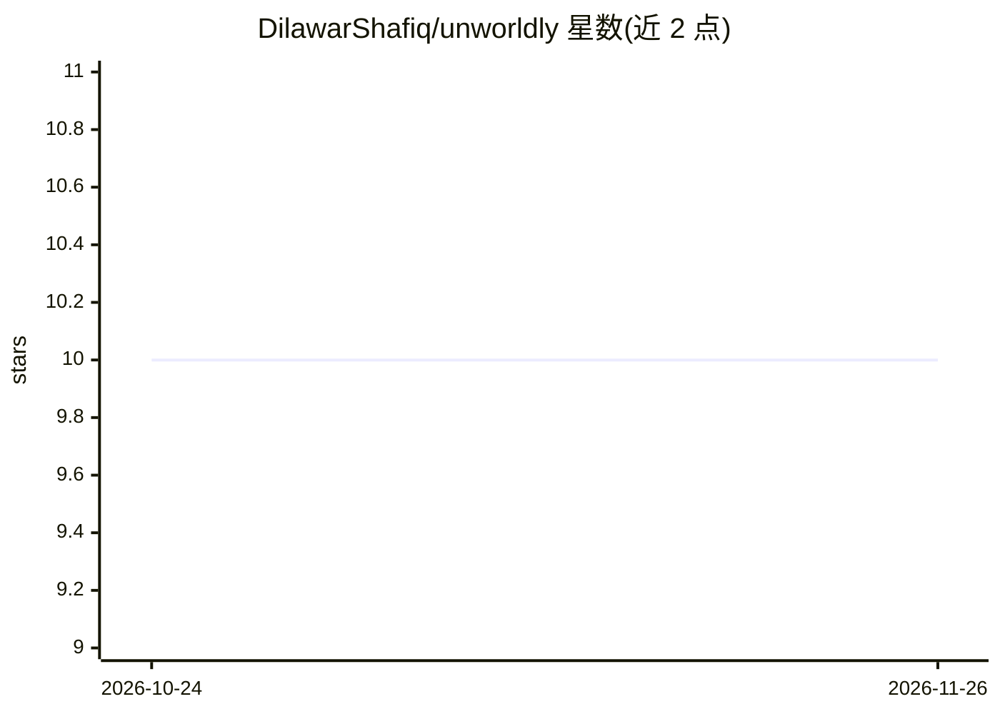

# DilawarShafiq/unworldly

⭐ 10 · Python · MIT · 推送 2026-11-25 · [GitHub](https://github.com/DilawarShafiq/unworldly) · [官网](https://pypi.org/project/unworldly-recorder/) · 个人维护

**给 AI 编码代理提供防篡改审计记录的本地监控 CLI**

本地运行的编码代理监控工具：记录代理在机器上所做的文件变更与 shell 命令，按四级捕获层适配不同代理形态（文件/进程监视、SDK 工具调用包装、MCP 代理、OpenTelemetry span 采集）。每次事件进入 SHA-256 哈希链以保证防篡改，提供 verify/replay/report 命令，内置启发式风险评分（凭证访问、破坏性命令、网络外呼）与代理身份自动识别（8 种）。默认 poll 模式对短命令可能漏采，shell-hook 模式无损；不捕获提示词与 LLM API 调用（隐私考量）。通过 pip 安装，本地优先、零云端数据上传。

## 筛选速览

| 维度 | 判定 | 备注 |
|---|---|---|
| AI 角色 | `ai-ecosystem` | LLM/agent 周边工具 |
| 许可风险 | `permissive` | MIT |
| 部署形态 | `library` | 以包/库形式分发 |
| 模型依赖 | — | README 未给出锁定关系 |
| 硬件要求 | — | 无带数字的原话,不猜 |
| 安装摩擦 | `low` | 无编译、无系统依赖或容器化 |
| 成熟度 | — | 结构信号不足 |

## 能力要点

- 四级捕获层：文件/进程、SDK trace、MCP proxy、OpenTelemetry
- SHA-256 哈希链防篡改日志与 verify 完整性校验
- 启发式风险引擎：凭证访问、rm -rf、curl 外呼等分级
- 自动识别 8 种运行中的 AI 代理身份

## 适用场景

- 审计本机编码代理对文件与 shell 的实际改动
- 安全团队对代理行为留存可验证的合规记录
- 按 ISO 42001 控制项构建 AI 管理体系审计日志

## 场景标签

`LLM 可观测性` `网络安全` · 领域:评测与运维

## 证据(README 行号)

> L3: Unworldly: a flight recorder for AI coding agents
> L55: |**L1 File + shell**|`unworldly watch` (+ `hook install` for lossless)|File changes + shell commands|Local coding a
> L141: - **Watch** — Passive filesystem + process monitoring. Zero interference with the agent

## 星数曲线

2026-10-24 10 → 2026-11-26 10（+0）

---
*卡片 v1 · prompt 1.4 · 生成 2026-11-20 · 置信度 mid · 依据 README sha `2bec100b12e7` · [字段定义](../../DATASET.md)*
