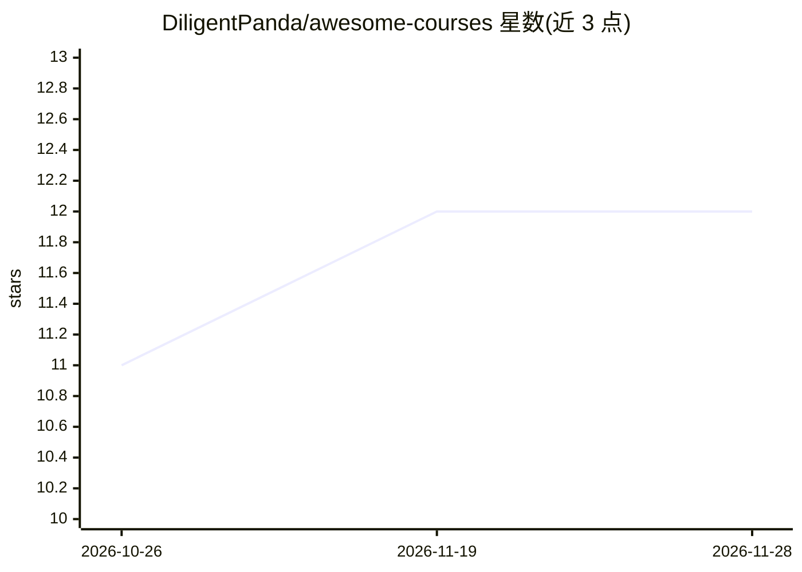

# DiligentPanda/awesome-courses

⭐ 12 · MIT · 推送 2026-08-06 · [GitHub](https://github.com/DiligentPanda/awesome-courses) · 个人维护

**AI、计算机与数学公开课程清单，收录大学开放课程链接**

一个持续更新的课程聚合清单，按 AI Agents、NLP、强化学习、深度学习、优化、控制与机器人等主题收录 CMU、Stanford、Berkeley、MIT 等学校的公开课程，每条含开课院校、学期、讲者、课程页、视频链接、代码作业与语言等字段；另有 Tutorials、通用资源（MIT OCW、Coursera 等）、书籍与演讲版块，部分条目标注 [TODO] 待补充。

## 筛选速览

| 维度 | 判定 | 备注 |
|---|---|---|
| AI 角色 | `ai-knowledge` | 知识聚合/清单类 |
| 许可风险 | `permissive` | MIT |
| 部署形态 | `None` |  |
| 模型依赖 | — | README 未给出锁定关系 |
| 硬件要求 | — | 无带数字的原话,不猜 |
| 安装摩擦 | `low` | 无编译、无系统依赖或容器化 |
| 成熟度 | — | 结构信号不足 |

## 能力要点

- 收录 CMU/Stanford/Berkeley/MIT 等高校公开课程，含课程页与视频链接
- 每条记录标注更新时间、讲者、代码作业与语言等结构化字段
- 覆盖 LLM Agent、NLP、RL、生成模型、优化、控制、机器人等主题
- 附 Tutorials、Books 与通用学习资源版块

## 适用场景

- 按主题查找可以自学的 AI/CS/数学公开课
- 查找某门课程的视频录像与代码作业资源
- 发现 LLM Agent、扩散模型等方向的最新课程链接

## 场景标签

`精选清单` · 领域:学习与行业

## 证据(README 行号)

> L2: I will collect a list of (open) courses first for AI, CS and Math. High-quality knowledge matters!
> L6: ## Courses

## 星数曲线

2026-10-26 11 → 2026-11-28 12（+1）

---
*卡片 v1 · prompt 1.4 · 生成 2026-11-19 · 置信度 high · 依据 README sha `2ce7cc760204` · [字段定义](../../DATASET.md)*
