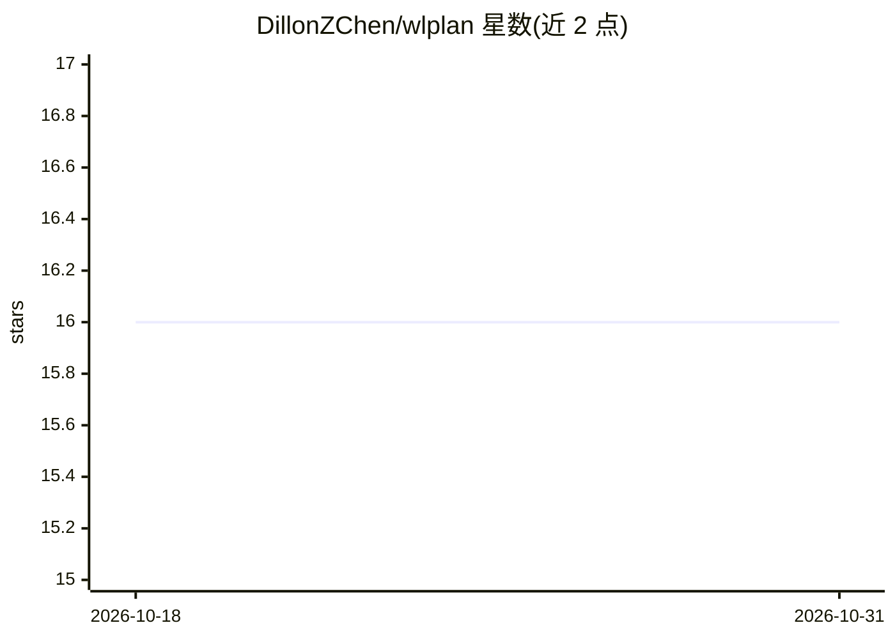

# DillonZChen/wlplan

⭐ 16 · C++ · MIT · 推送 2026-03-27 · [GitHub](https://github.com/DillonZChen/wlplan) · [官网](https://dillonzchen.github.io/wlplan/) · 个人维护

**为 PDDL 规划问题生成图表示与 WL 特征嵌入的机器学习库**

WLPlan 提供 Python 与 C++ 接口，将经典与数值规划问题和状态转换为图表示，再通过 Weisfeiler-Leman 算法变体合成特征嵌入，供机器学习任务使用。核心流程仅需三行代码：初始化特征生成器、收集数据集、生成嵌入。PyPI 发布版要求 python>=3.10，也可经 install.sh 从源码安装，C++ 端通过 cmake 构建集成。多篇 ICAPS/ECAI/NeurIPS 论文使用该库。

## 筛选速览

| 维度 | 判定 | 备注 |
|---|---|---|
| AI 角色 | `ai-native` | 本体是模型或模型工具 |
| 许可风险 | `permissive` | MIT |
| 部署形态 | `library` | 以包/库形式分发 |
| 模型依赖 | — | README 未给出锁定关系 |
| 硬件要求 | — | 无带数字的原话,不猜 |
| 安装摩擦 | `low` | 无编译、无系统依赖或容器化 |
| 成熟度 | — | 结构信号不足 |

## 能力要点

- 将 PDDL 规划问题与状态转换为图表示
- 运行 WL 算法变体合成特征嵌入
- 同时支持经典与数值规划问题
- 提供 Python（pip）与 C++（CMake）两种接口

## 适用场景

- 为学习规划启发式函数生成输入特征
- 对规划问题做基于图嵌入的机器学习实验
- 在 C++ 规划系统中集成 WL 特征计算

## 场景标签

 · 领域:自动规划/机器学习

## 证据(README 行号)

> L8:  Plan is a library for generating graph representations and feature embeddings of PDDL planning problems and states 
> L10: The main pipeline in WLPlan consists of (1) converting planning problems and states into graphs, and (2) synthesisi

## 星数曲线

2026-10-18 16 → 2026-10-31 16（+0）

---
*卡片 v1 · prompt 1.4 · 生成 2026-10-30 · 置信度 high · 依据 README sha `8cd97ff9ad97` · [字段定义](../../DATASET.md)*
