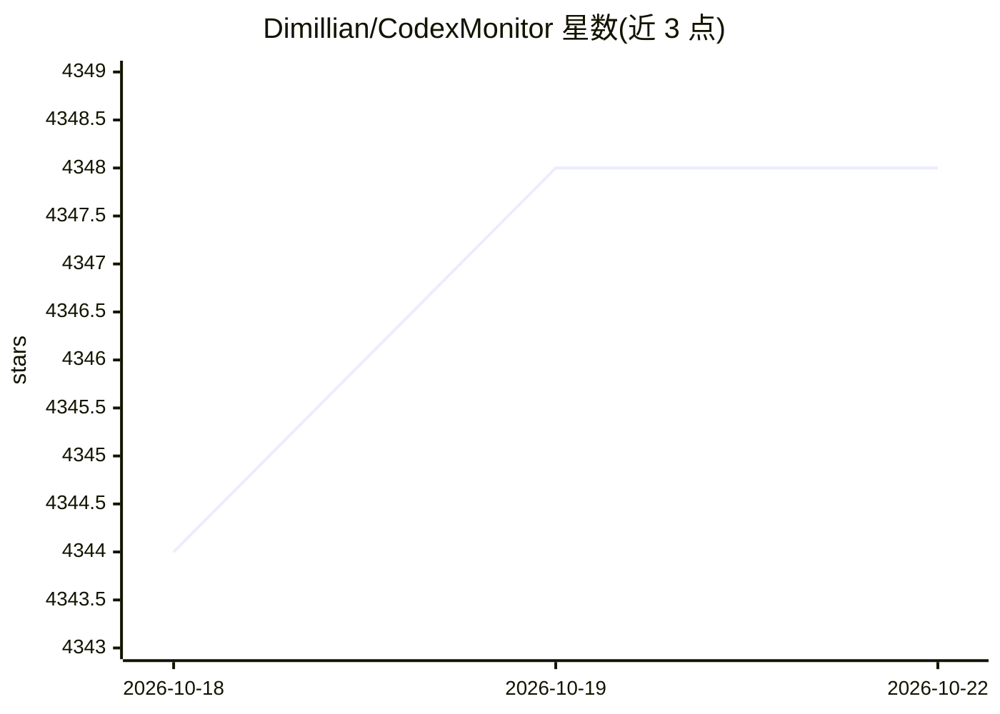

# Dimillian/CodexMonitor

⭐ 4,349 · TypeScript · MIT · 推送 2026-03-26 · [GitHub](https://github.com/Dimillian/CodexMonitor) · [官网](https://www.codexmonitor.app) · 个人维护

**编排多个 Codex agent 的 Tauri 桌面客户端，含 iOS 远程模式**

基于 Tauri 的桌面应用，用于在本地工作区中编排多个 Codex agent：每个工作区生成一个 codex app-server 进程，提供会话管理（恢复/置顶/归档/中断）、worktree/clone 隔离代理、图像附件编写器、模型与推理力度选择、Whisper 听写，以及 Git/GitHub 集成（diff、分支、Issues/PR）。支持远程 daemon 模式与 iOS 端经 Tailscale 连接桌面后端；iOS 支持标注为进行中，终端与听写在移动端不可用。构建需 Node.js、Rust 工具链、CMake 等依赖。

## 筛选速览

| 维度 | 判定 | 备注 |
|---|---|---|
| AI 角色 | `ai-ecosystem` | LLM/agent 周边工具 |
| 许可风险 | `permissive` | MIT |
| 部署形态 | `library` | 以包/库形式分发 |
| 模型依赖 | — | README 未给出锁定关系 |
| 硬件要求 | — | 无带数字的原话,不猜 |
| 安装摩擦 | `medium` | 含编译或系统依赖之一 |
| 成熟度 | — | 结构信号不足 |

## 能力要点

- 每工作区生成 codex app-server，支持会话恢复与运行状态跟踪
- worktree/clone 隔离代理与远程 daemon 模式
- Git/GitHub 集成：diff、分支、Issues/PR 与 PR composer
- iOS 经 Tailscale 连接桌面 daemon 的远程后端流程

## 适用场景

- 在多个本地项目中并行管理 Codex agent 会话
- 用隔离 worktree 让代理在独立环境工作
- 在手机上远程接入桌面机运行的 Codex 后端

## 场景标签

`编码 Agent` · 领域:编码与开发

## 证据(README 行号)

> L7: CodexMonitor is a Tauri app for orchestrating multiple Codex agents across local workspaces. It provides a sidebar t
> L277: - The app uses `codex app-server` over stdio; see `src-tauri/src/lib.rs` and `src-tauri/src/codex/`.

## 星数曲线

2026-10-18 4,344 → 2026-10-22 4,348（+4）

---
*卡片 v1 · prompt 1.4 · 生成 2026-10-21 · 置信度 high · 依据 README sha `40980d9fa906` · [字段定义](../../DATASET.md)*
