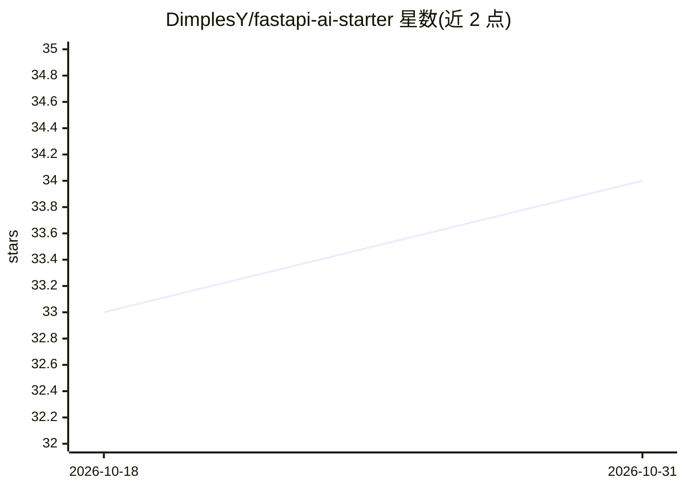

# DimplesY/fastapi-ai-starter

⭐ 34 · Python · 推送 2026-07-31 · [GitHub](https://github.com/DimplesY/fastapi-ai-starter) · 个人维护 · 中文 README

**构建 AI 应用的 FastAPI 后端项目模板（Celery+pgvector+Redis）**

生产就绪的 FastAPI 项目模板：集成 Celery+Redis 异步任务队列、PostgreSQL 16 + pgvector 向量存储与搜索、JWT 认证（bcrypt 加密）、Alembic 自动数据库迁移、Docker Compose + Nginx + Supervisord 容器化部署。采用服务工厂模式管理依赖注入，服务通过 ServiceManager 自动发现注册。面向希望快速搭建带 AI 能力（向量检索）后端服务的 Python 开发者。环境要求 Python 3.12+ 与 Docker。

## 筛选速览

| 维度 | 判定 | 备注 |
|---|---|---|
| AI 角色 | `ai-ecosystem` | LLM/agent 周边工具 |
| 许可风险 | `none` | — |
| 部署形态 | `self-host` | docker 或自建部署 |
| 模型依赖 | — | README 未给出锁定关系 |
| 硬件要求 | — | 无带数字的原话,不猜 |
| 安装摩擦 | `low` | 无编译、无系统依赖或容器化 |
| 成熟度 | — | 结构信号不足 |

## 能力要点

- 服务工厂架构，自动管理服务生命周期与依赖注入
- PostgreSQL + pgvector 扩展，支持向量存储和搜索
- FastAPI + SQLModel 异步全栈 + Celery 任务队列
- Docker Compose + Nginx + Supervisord 容器化部署

## 适用场景

- 快速启动一个带向量检索能力的 AI 应用后端
- 搭建含异步任务队列的生产级 Web 服务
- 基于模板学习 FastAPI 服务分层与依赖注入架构

## 场景标签

 · 领域:Web 后端/AI 应用基础设施

## 证据(README 行号)

> L3: 一个生产就绪的 FastAPI 项目模板，集成 Celery 异步任务、PostgreSQL/pgvector 和 Redis，适合构建 AI 应用。
> L15: - **AI 就绪** - PostgreSQL + pgvector 扩展，支持向量存储和搜索

## 星数曲线

2026-10-18 33 → 2026-10-31 34（+1）

---
*卡片 v1 · prompt 1.4 · 生成 2026-10-26 · 置信度 high · 依据 README sha `91e1415cf696` · [字段定义](../../DATASET.md)*
