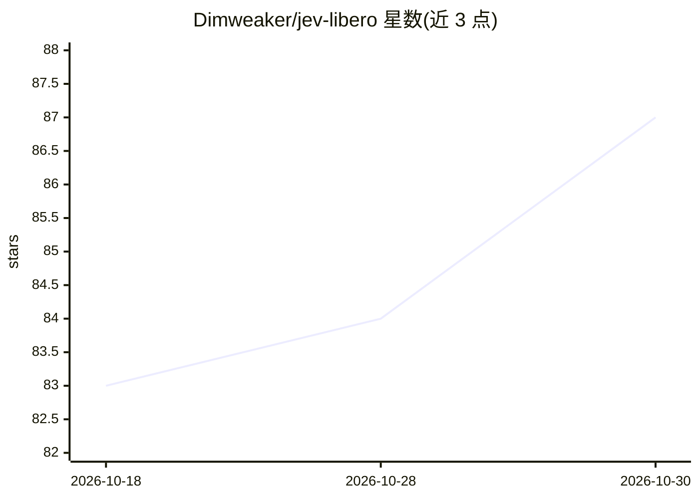

# Dimweaker/jev-libero

⭐ 87 · Python · MIT · 推送 2026-09-21 · [GitHub](https://github.com/Dimweaker/jev-libero) · [官网](https://dimweaker.github.io/jev-libero/) · 个人维护 · 中文 README

**用 Jev LLM 决策控制 LIBERO 机器人操作任务的工具包**

面向机器人操作研究的 Python 包：将 Jev 模型决策接入 LIBERO/robosuite/MuJoCo 仿真环境，通过 27 个细粒度输入（笛卡尔平移、腕部旋转、夹爪等）分层选择意图、动作族与控制输入；执行前用可逆物理预演评估候选效果，任务（微波炉、抽屉、抓取汤罐等）以 JSON 配置测量、特征与目标。通过 TypeSafe 或 OpenRouter 付费 API 运行，回放已录制轨迹无需 API 调用。附测试与模拟校验。

## 筛选速览

| 维度 | 判定 | 备注 |
|---|---|---|
| AI 角色 | `ai-native` | 本体是模型或模型工具 |
| 许可风险 | `permissive` | MIT |
| 部署形态 | `library` | 以包/库形式分发 |
| 模型依赖 | locked-api |  |
| 硬件要求 | — | 无带数字的原话,不猜 |
| 安装摩擦 | `low` | 无编译、无系统依赖或容器化 |
| 成熟度 | — | 结构信号不足 |

## 能力要点

- 27 输入细粒度控制与三层决策（意图→动作族→输入）
- 可逆物理预演（最长 8 步/0.4 仿真秒）评估候选效果
- JSON 配置自定义任务，无需任务专属执行器
- TypeSafe 与 OpenRouter 两种 API 通道，支持预算上限

## 适用场景

- 在 LIBERO 仿真中运行 LLM 驱动的机器人操作任务
- 自定义测量与目标，搭建自己的操作任务
- 回放与检查已录制轨迹的决策与物理状态

## 场景标签

`科研工具` · 领域:学习与行业

## 证据(README 行号)

> L30: - **Fine-grained control.** 27 inputs covering Cartesian translations, wrist rotations, gripper open/close, and hol
> L31: - **Layered decisions.** Jev selects an intent, a contact/motion family, and an input, with each choice informing t
> L98: Both routes use the same control pipeline. TypeSafe calls `/v1/systemone` with `jev-latest`; OpenRouter uses `types

## 星数曲线

2026-10-18 83 → 2026-10-30 87（+4）

---
*卡片 v1 · prompt 1.4 · 生成 2026-10-24 · 置信度 mid · 依据 README sha `ad8c6c539009` · [字段定义](../../DATASET.md)*
