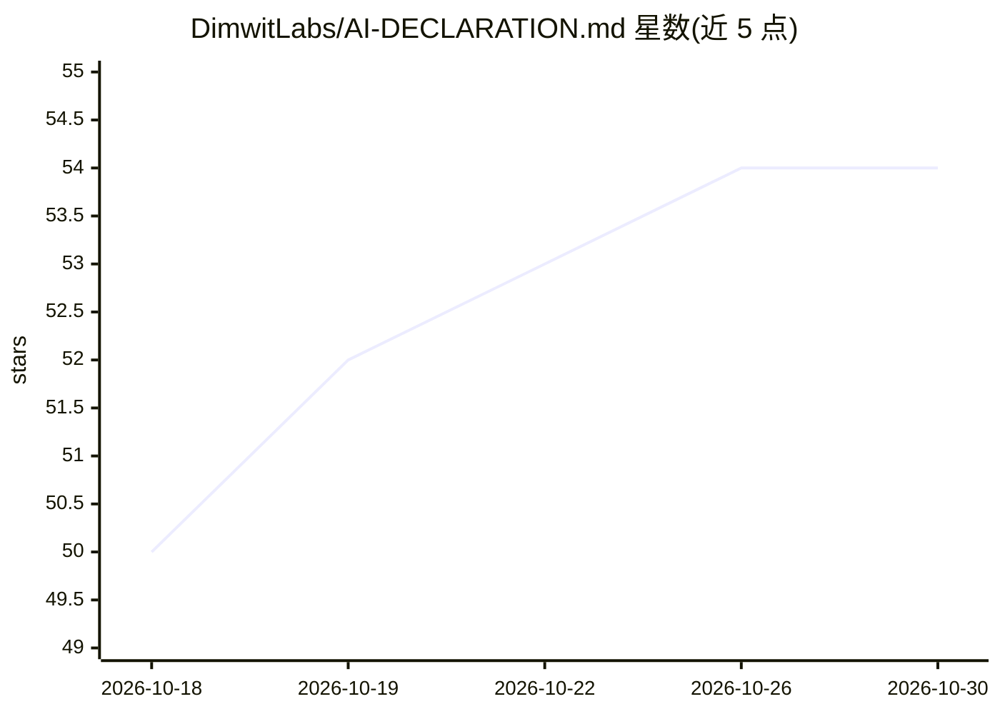

# DimwitLabs/AI-DECLARATION.md

⭐ 54 · HTML · MIT · 推送 2026-10-29 · [GitHub](https://github.com/DimwitLabs/AI-DECLARATION.md) · [官网](https://ai-declaration.md) · 个人维护

**声明软件项目中 AI 使用程度的开放规范（AI-DECLARATION.md）**

一份开放规范，倡议软件仓库包含结构化的 AI-DECLARATION.md 文件：以 YAML frontmatter 声明 version、level 等必填字段，正文附 Notes 说明。定义 6 个 AI 参与级别（none/hint/assist/pair/copilot/auto），可按 design、implementation、testing 等 6 类开发过程及文件/目录粒度分别声明，并提供 YAML schema 供校验和工具构建。面向希望公开 AI 参与情况的开发者与团队；规范本身不含可运行代码，周边工具（生成器、校验 API、Reddit 机器人）以资源链接形式列出。

## 筛选速览

| 维度 | 判定 | 备注 |
|---|---|---|
| AI 角色 | `ai-knowledge` | 知识聚合/清单类 |
| 许可风险 | `permissive` | MIT |
| 部署形态 | `None` |  |
| 模型依赖 | — | README 未给出锁定关系 |
| 硬件要求 | — | 无带数字的原话,不猜 |
| 安装摩擦 | `low` | 无编译、无系统依赖或容器化 |
| 成熟度 | — | 结构信号不足 |

## 能力要点

- 定义 none 到 auto 共 6 级 AI 参与程度
- 支持按 6 类开发过程与文件/目录组件粒度声明
- 提供 YAML schema 用于校验声明文件
- 配套徽章与 FAQ，支持翻译与规范演进贡献

## 适用场景

- 在我的开源仓库中公开声明代码的 AI 生成程度
- 按开发阶段或具体文件分别标注 AI 参与级别
- 基于规范构建自动生成与解析 AI 声明的工具

## 场景标签

 · 领域:软件开发/AI 治理规范

## 证据(README 行号)

> L7: AI-generated code is a reality of our time and it is both a blessing and a curse. The problem is not the code in its
> L13: An `AI-DECLARATION.md` file uses YAML frontmatter for structured fields, followed by a required `## Notes` section 

## 星数曲线

2026-10-18 50 → 2026-10-30 54（+4）

---
*卡片 v1 · prompt 1.4 · 生成 2026-10-24 · 置信度 mid · 依据 README sha `69736dd05727` · [字段定义](../../DATASET.md)*
