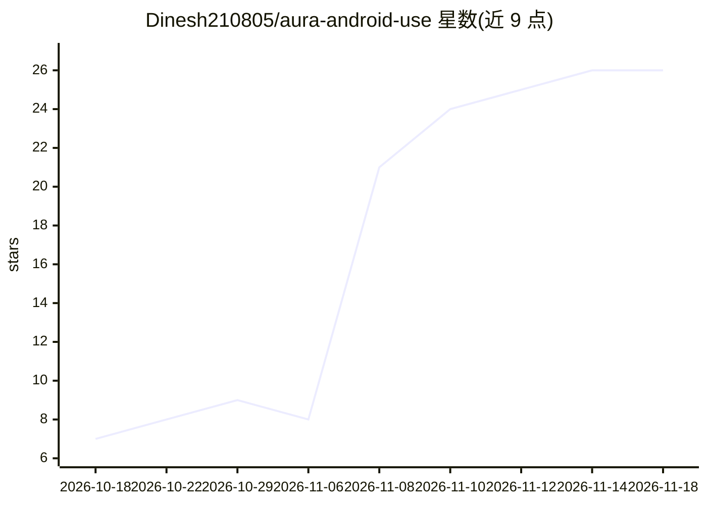

# Dinesh210805/aura-android-use

⭐ 26 · Kotlin · AGPL-3.0 · 推送 2026-11-17 · [GitHub](https://github.com/Dinesh210805/aura-android-use) · [官网](https://aura-android-use.vercel.app) · 个人维护

**让 AI agent 直接操控 Android 手机的端侧助手与 MCP 服务器**

运行在 Android 手机上的 AI agent：通过无障碍服务读取屏幕并代替用户点击、输入、滚动，可经语音或文字在手机上直接下达任务，也可将 50+ 工具以 MCP 服务器形式暴露给电脑上的 Claude Code、Cursor 等客户端（经局域网 WebRTC 桥接，PIN 配对）。模型自选：Gemini、Anthropic、OpenAI、Groq、OpenRouter、DeepSeek 等均以自带 API key 接入。屏幕感知结合无障碍树与端侧视觉模型（YOLOv8 + OCR），内置安全门：银行/支付/验证器类应用禁止打开，敏感信息禁止输入。需 Android 8.0+，无需 root；桌面桥接需 Node.js 18+。作者声明为个人独立项目，存在已知缺陷。

## 筛选速览

| 维度 | 判定 | 备注 |
|---|---|---|
| AI 角色 | `ai-native` | 本体是模型或模型工具 |
| 许可风险 | `dual` | AGPL-3.0 |
| 部署形态 | `library` | 以包/库形式分发 |
| 模型依赖 | locked-api |  |
| 硬件要求 | — | 无带数字的原话,不猜 |
| 安装摩擦 | `medium` | 含编译或系统依赖之一 |
| 成熟度 | `idea` | |

## 能力要点

- 50+ 工具经 MCP 暴露，手机端 agent 与电脑端 MCP 客户端共用同一服务器与安全门
- 屏幕感知结合无障碍树与端侧视觉模型（YOLOv8 + OCR），按编号选元素而非猜坐标
- 支持 12+ 家 LLM 提供商及任意 OpenAI 兼容端点，自带 key 随时切换
- 离线唤醒词（sherpa-onnx）、Gemini Live 对话模式、Groq Whisper 语音转文字

## 适用场景

- 在手机上用语音或文字让 AI 代为操作真实应用
- 让电脑上的 Claude Code / Cursor 等 MCP 客户端操控真机做应用测试或自动化
- 给编码 agent 提供一双操控 Android 设备的手

## 场景标签

`GUI 自动化` · 领域:效率与自动化

## 证据(README 行号)

> L72: **🔌 An MCP server inside the phone.** The same 50+ tools are exposed over the
> L73: Model Context Protocol, so an AI agent on your computer can
> L88: 2. **The agent runs on the phone.** It sends your goal and what's on screen to the LLM you
> L89:  picked, and gets back the next tool to call.

## 星数曲线

2026-10-18 7 → 2026-11-18 26（+19）

---
*卡片 v1 · prompt 1.4 · 生成 2026-11-18 · 置信度 high · 依据 README sha `ba4df3e67aef` · [字段定义](../../DATASET.md)*
