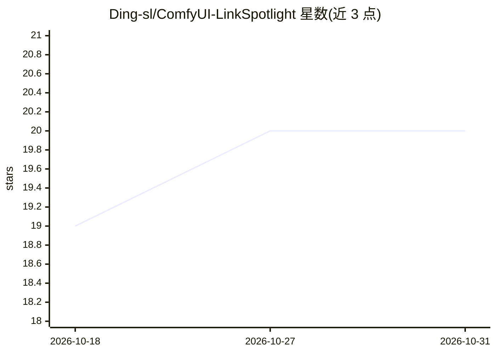

# Ding-sl/ComfyUI-LinkSpotlight

⭐ 20 · JavaScript · MIT · 推送 2026-10-21 · [GitHub](https://github.com/Ding-sl/ComfyUI-LinkSpotlight) · [官网](https://www.patreon.com/Dingsl) · 个人维护

**ComfyUI 前端扩展：一键高亮选中节点相关连线，隐藏其余连线**

纯前端的 ComfyUI 扩展，不注册任何节点、无 Python 依赖。按 Alt+H（可改键）或工具栏/菜单按钮切换聚光灯模式：隐藏或以可配置透明度压暗与选中节点无关的连线，支持多选与组选、1-3 跳或全谱系追踪、上游/下游方向限定、悬停跟随与节点压暗。通过包装画布连线渲染路径实现，不修改工作流数据；包装的是内部前端 API，ComfyUI 更新改名时扩展会自动禁用而不破坏画布。

## 筛选速览

| 维度 | 判定 | 备注 |
|---|---|---|
| AI 角色 | `ai-ecosystem` | LLM/agent 周边工具 |
| 许可风险 | `permissive` | MIT |
| 部署形态 | `None` |  |
| 模型依赖 | — | README 未给出锁定关系 |
| 硬件要求 | — | 无带数字的原话,不猜 |
| 安装摩擦 | `low` | 无编译、无系统依赖或容器化 |
| 成熟度 | — | 结构信号不足 |

## 能力要点

- Alt+H 可改键切换，支持按钮/菜单/命令面板多种入口
- 深度（1-3 跳或 ∞）与方向（上游/下游）可配置，reroute 节点不消耗跳数
- 隐藏或压暗两种模式，可同时压暗无关节点与分组
- 纯前端实现，零节点零依赖，关闭时开销为单次布尔检查

## 适用场景

- 编辑大型 spaghetti 工作流时只看选中节点相关的连线
- 探索陌生工作流时用悬停模式跟随查看节点连线
- 追踪某节点上下游数据来源与去向

## 场景标签

 · 领域:AI 工作流工具/前端扩展

## 证据(README 行号)

> L11: instantly see only the links that matter: LinkSpotlight hides (or dims) every
> L66: Restart ComfyUI (or reload the browser page). No Python dependencies — this

## 星数曲线

2026-10-18 19 → 2026-10-31 20（+1）

---
*卡片 v1 · prompt 1.4 · 生成 2026-10-28 · 置信度 high · 依据 README sha `990676e949d7` · [字段定义](../../DATASET.md)*
