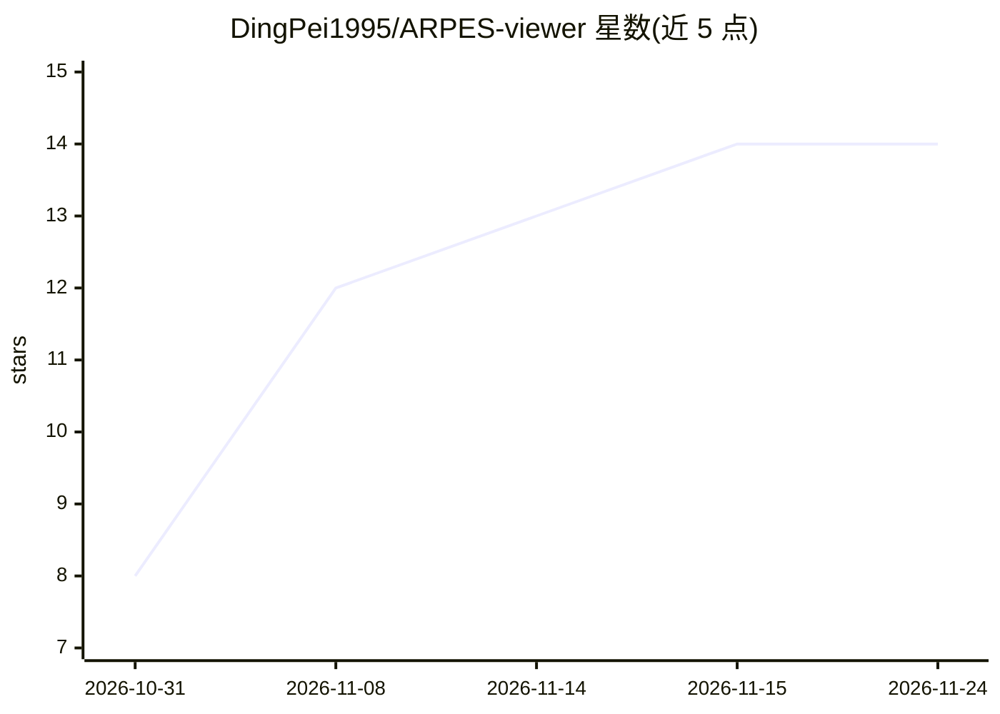

# DingPei1995/ARPES-viewer

⭐ 14 · Python · NOASSERTION · 推送 2026-11-21 · [GitHub](https://github.com/DingPei1995/ARPES-viewer) · 个人维护 · 中文 README

**ARPES 实验数据到出版级图像的 PyQt 分析工具，可由 AI agent 驱动**

Python/PyQt5 编写的 ARPES（角分辨光电子能谱）数据分析程序：浏览 beamtime 测量数据、动量转换、Fermi 边与 MDC/EDC 拟合、布里渊区叠加、紧束缚拟合及与 DFT/Wannier 计算对比，最终排版为出版图像。读取 12+ 同步辐射线站格式。每个分析步骤均以纯 Python 暴露，内置 AI assistant 面板生成提示词供 Claude 桌面版/Claude Code/任意文件读写 agent 驱动，也可经 MCP（arpes-viewer-mcp）调用约 50 个文档化操作；数据留在本地，agent 每步可见、可暂停接管。仅限非商业用途。

## 筛选速览

| 维度 | 判定 | 备注 |
|---|---|---|
| AI 角色 | `ai-enhanced` | 去掉 AI 部分产品仍成立 |
| 许可风险 | `none` | NOASSERTION |
| 部署形态 | `library` | 以包/库形式分发 |
| 模型依赖 | — | README 未给出锁定关系 |
| 硬件要求 | — | 无带数字的原话,不猜 |
| 安装摩擦 | `low` | 无编译、无系统依赖或容器化 |
| 成熟度 | — | 结构信号不足 |

## 能力要点

- 读取 12+ 同步辐射线站格式（SOLEIL/ALS/ALBA/Diamond/MAX IV 等）
- AI assistant 面板生成提示词，agent 逐步驱动且可随时暂停
- MCP 通道以约 50 个文档化 API 低 token 成本调用
- 与 Wien2k/VASP/Quantum ESPRESSO/Wannier90/FPLO 计算能带对比

## 适用场景

- 从线站原始文件到投稿图像的完整 ARPES 分析流程
- 让 AI agent 按自然语言指令批量处理 kz 图谱并生成报告
- 拟合 Fermi 边并计算自能
- 实验数据与紧束缚/DFT 计算能带的对比可视化

## 场景标签

`数据分析` · 领域:效率与自动化

## 证据(README 行号)

> L12: A Python/PyQt5 program for ARPES data: browse the measurements of a
> L132: and every step is plain Python that a script -- or an **AI agent** -- can
> L172: - **Other routes**: an MCP app (`arpes-viewer-mcp`; with the program

## 星数曲线

2026-10-31 8 → 2026-11-24 14（+6）

---
*卡片 v1 · prompt 1.4 · 生成 2026-11-18 · 置信度 high · 依据 README sha `fcaf469de7c9` · [字段定义](../../DATASET.md)*
