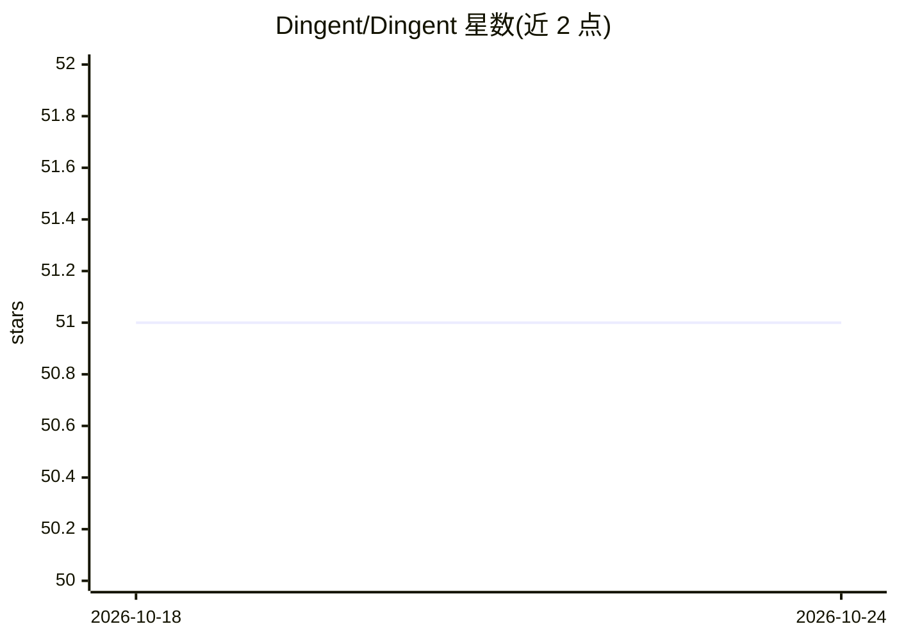

# Dingent/Dingent

⭐ 51 · TypeScript · MIT · 推送 2026-06-24 · [GitHub](https://github.com/Dingent/Dingent) · [官网](https://ngdc.cncb.ac.cn/dingent/) · 组织维护

**跨平台 LLM Agent 框架：后端+前端+协作的一体化部署**

将 FastAPI 后端与 Next.js 前端组合为一个可部署应用的 AI agent 框架，包含工作区成员与角色管理、本地邮箱密码认证（签发 JWT）、面向 CAS 与企业私有 SSO 的开放扩展点，以及助手/工作流/插件/市场/模型配置等服务，并提供聊天运行时 API。数据层用 SQLModel 与 Alembic 迁移，开发流程通过 uv、bun 与 justfile 管理。项目处于活跃开发阶段，当前代码围绕内置 FastAPI 服务与 ui/ 前端展开。

## 筛选速览

| 维度 | 判定 | 备注 |
|---|---|---|
| AI 角色 | `ai-ecosystem` | LLM/agent 周边工具 |
| 许可风险 | `permissive` | MIT |
| 部署形态 | `None` |  |
| 模型依赖 | — | README 未给出锁定关系 |
| 硬件要求 | — | 无带数字的原话,不猜 |
| 安装摩擦 | `low` | 无编译、无系统依赖或容器化 |
| 成熟度 | `idea` | |

## 能力要点

- FastAPI 后端 + Next.js 前端 + 工作区协作的一体化 agent 应用
- 双层认证模型：外部 SSO + Dingent JWT 与工作区权限
- SSO 扩展点支持 CAS 与私有企业 provider（含 Java SDK 兼容等私部层建议）
- 助手、工作流、插件、市场、日志、模型配置服务与聊天运行时 API

## 适用场景

- 搭建带多工作区协作的 LLM agent 应用平台
- 企业通过 CAS 或私有 SSO 接入统一的 agent 服务
- 在此框架上开发数据检索类 agent 应用

## 场景标签

`Agent 框架` · 领域:Agent 开发

## 证据(README 行号)

> L3: Dingent is a cross-platform AI agent framework. It combines a Python backend, a Next.js frontend, workspace-based co
> L15: - Assistant, workflow, plugin, market, logging, and model configuration services.

## 星数曲线

2026-10-18 51 → 2026-10-24 51（+0）

---
*卡片 v1 · prompt 1.4 · 生成 2026-10-24 · 置信度 high · 依据 README sha `694f3de4bc6e` · [字段定义](../../DATASET.md)*
