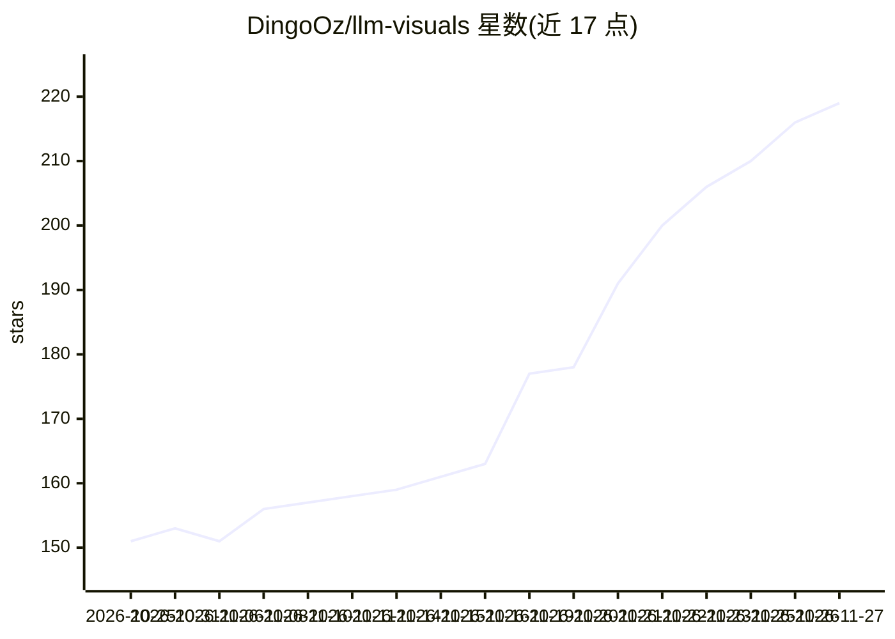

# DingoOz/llm-visuals

⭐ 219 · Rust · MIT · 推送 2026-11-25 · [GitHub](https://github.com/DingoOz/llm-visuals) · 个人维护

**本地终端仪表盘：实时展示本机 LLM 推理服务器与 GPU 指标**

用 Rust/Ratatui 编写的真彩终端 TUI，自动探测本机已在运行的推理服务器（llama.cpp、ollama、vLLM、SGLang 等），读取其计数器与 NVIDIA/AMD/Intel GPU 遥测，实时显示 tokens/s、首 token 延迟、GPU 负载与显存、上下文填充、投机解码接受率、各 GPU 上的层占用；打补丁后还可显示 MoE 模型的专家路由。提供演示模式、SQLite 日志（--log-db）、跨平台预编译二进制与源码构建，Windows/macOS 支持较新且处于待验证阶段。

## 筛选速览

| 维度 | 判定 | 备注 |
|---|---|---|
| AI 角色 | `ai-ecosystem` | LLM/agent 周边工具 |
| 许可风险 | `permissive` | MIT |
| 部署形态 | `desktop` | 安装包/桌面程序 |
| 模型依赖 | local-ok | 支持本地模型 |
| 硬件要求 | — | 无带数字的原话,不猜 |
| 安装摩擦 | `high` | 编译与系统依赖俱全 |
| 成熟度 | `idea` | |

## 能力要点

- 自动探测本机推理服务器，扫描 /proc 与命令行解析模型、端口、上下文与 GGUF 头
- 实时 tok/s、TTFT、GPU 负载/显存、上下文填充与 MTP 接受率
- 可显示 MoE 模型逐 token 的专家路由（需服务器小补丁）
- 支持 Linux/macOS/Windows 六个预编译目标与跨编译脚本

## 适用场景

- 本地跑 llama.cpp 时观察吞吐与各 GPU 层分布
- 调试 MoE 模型想看专家路由情况
- 监控本机多卡推理的显存与功耗

## 场景标签

`LLM 可观测性` · 领域:评测与运维

## 证据(README 行号)

> L3: **A live terminal dashboard for the LLM running on your machine.**
> L5: It finds the inference servers you already have up (llama.cpp `llama-server`,
> L25: Requirements: a Rust toolchain (1.75+), `nvidia-smi` for NVIDIA GPU panels,

## 星数曲线

2026-10-25 151 → 2026-11-27 219（+68）

---
*卡片 v1 · prompt 1.4 · 生成 2026-11-26 · 置信度 mid · 依据 README sha `6756ed968ae9` · [字段定义](../../DATASET.md)*
