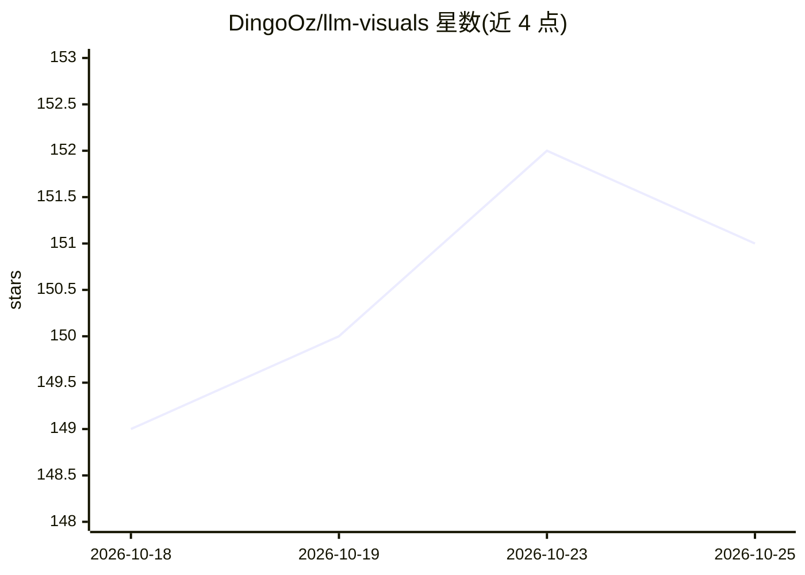

# DingoOz/llm-visuals

⭐ 151 · Rust · MIT · 推送 2026-10-24 · [GitHub](https://github.com/DingoOz/llm-visuals) · 个人维护

**本地 LLM 推理服务的真彩色终端实时监控面板**

用 Rust/ratatui 编写的 TUI 仪表盘：自动发现本机运行的推理服务（llama.cpp llama-server、ollama、vLLM、SGLang 等），读取其计数器与 NVIDIA/AMD/Intel/Apple GPU 遥测，展示 tok/s、TTFT、GPU 负载与显存、上下文填充、投机解码接受率、分层 GPU 分布；配合服务端补丁可显示 MoE 专家路由。自动检测通过扫描 /proc、解析命令行与 GGUF 头实现。面向在本地跑模型的开发者和用户；Windows/macOS 支持为新近添加且未经完整实测，端点仅支持明文 HTTP。

## 筛选速览

| 维度 | 判定 | 备注 |
|---|---|---|
| AI 角色 | `ai-ecosystem` | LLM/agent 周边工具 |
| 许可风险 | `permissive` | MIT |
| 部署形态 | `desktop` | 安装包/桌面程序 |
| 模型依赖 | local-ok | 支持本地模型 |
| 硬件要求 | — | 无带数字的原话,不猜 |
| 安装摩擦 | `high` | 编译与系统依赖俱全 |
| 成熟度 | `idea` | |

## 能力要点

- tok/s、TTFT、GPU 负载/显存、上下文填充、MTP 接受率等实时指标
- 自动检测本机推理服务（/proc 扫描、命令行解析、GGUF 头读取）
- 配合小补丁可显示 MoE 模型的逐 token 专家路由
- 六平台预编译二进制（Linux/macOS/Windows × x86-64/ARM64）与演示模式

## 适用场景

- 在终端实时观察本地 LLM 服务的吞吐与 GPU 占用
- 排查多卡部署下各层/专家的分布情况
- 无服务器时用 --demo 演示模式体验面板

## 场景标签

`LLM 可观测性` · 领域:评测与运维

## 证据(README 行号)

> L5: It finds the inference servers you already have up (llama.cpp `llama-server`,
> L7: GPU telemetry, and turns them into a truecolor picture of what the model is doing

## 星数曲线

2026-10-18 149 → 2026-10-25 151（+2）

---
*卡片 v1 · prompt 1.4 · 生成 2026-10-22 · 置信度 mid · 依据 README sha `002cd1092f50` · [字段定义](../../DATASET.md)*
