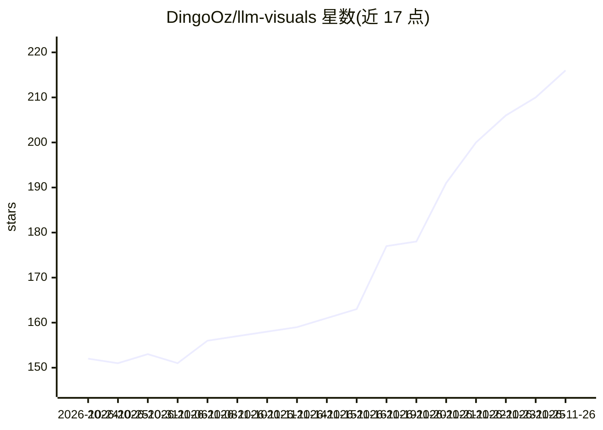

# DingoOz/llm-visuals

⭐ 216 · Rust · MIT · 推送 2026-11-25 · [GitHub](https://github.com/DingoOz/llm-visuals) · 个人维护

**为本地运行的 LLM 推理服务器提供终端实时监控仪表盘**

用 Rust 编写的终端 TUI 仪表盘：自动探测本机已在运行的推理服务器（llama.cpp、ollama、vLLM、SGLang 等），读取服务器计数器与 NVIDIA/AMD/Intel GPU 遥测，展示 tok/s、TTFT、GPU 负载与显存、上下文占用、投机解码接受率、各 GPU 上的层分布；打补丁后还可显示 MoE 模型的专家路由。提供 demo 模式无需服务器，Windows/macOS/Linux 提供 x86-64 与 ARM64 预编译二进制，日志可写入 SQLite。

## 筛选速览

| 维度 | 判定 | 备注 |
|---|---|---|
| AI 角色 | `ai-ecosystem` | LLM/agent 周边工具 |
| 许可风险 | `permissive` | MIT |
| 部署形态 | `desktop` | 安装包/桌面程序 |
| 模型依赖 | local-ok | 支持本地模型 |
| 硬件要求 | — | 无带数字的原话,不猜 |
| 安装摩擦 | `high` | 编译与系统依赖俱全 |
| 成熟度 | — | 结构信号不足 |

## 能力要点

- 自动探测本地推理服务器并解析 GGUF 架构、端口、上下文与张量切分
- 读取 NVIDIA (nvidia-smi)、Intel (xpu-smi)、AMD、Apple silicon (macmon/powermetrics) GPU 遥测
- 显示 MoE 专家路由（需对服务器打补丁）与投机解码接受率
- 三个平台六种架构提供预编译二进制，带 --demo 合成模式

## 适用场景

- 本地跑 llama.cpp/ollama 时实时观察推理吞吐与 TTFT
- 监控 GPU 利用率、显存与上下文填充情况
- 查看 MoE 模型每个 token 路由到哪些专家

## 场景标签

`LLM 可观测性` · 领域:评测与运维

## 证据(README 行号)

> L3: **A live terminal dashboard for the LLM running on your machine.**
> L5: It finds the inference servers you already have up (llama.cpp `llama-server`,
> L6: ollama, vLLM, SGLang, Strata, Maya, NInfer, TensorFold, …), reads their counters and NVIDIA, AMD or Intel

## 星数曲线

2026-10-24 152 → 2026-11-26 216（+64）

---
*卡片 v1 · prompt 1.4 · 生成 2026-11-25 · 置信度 mid · 依据 README sha `cd0eb000c489` · [字段定义](../../DATASET.md)*
