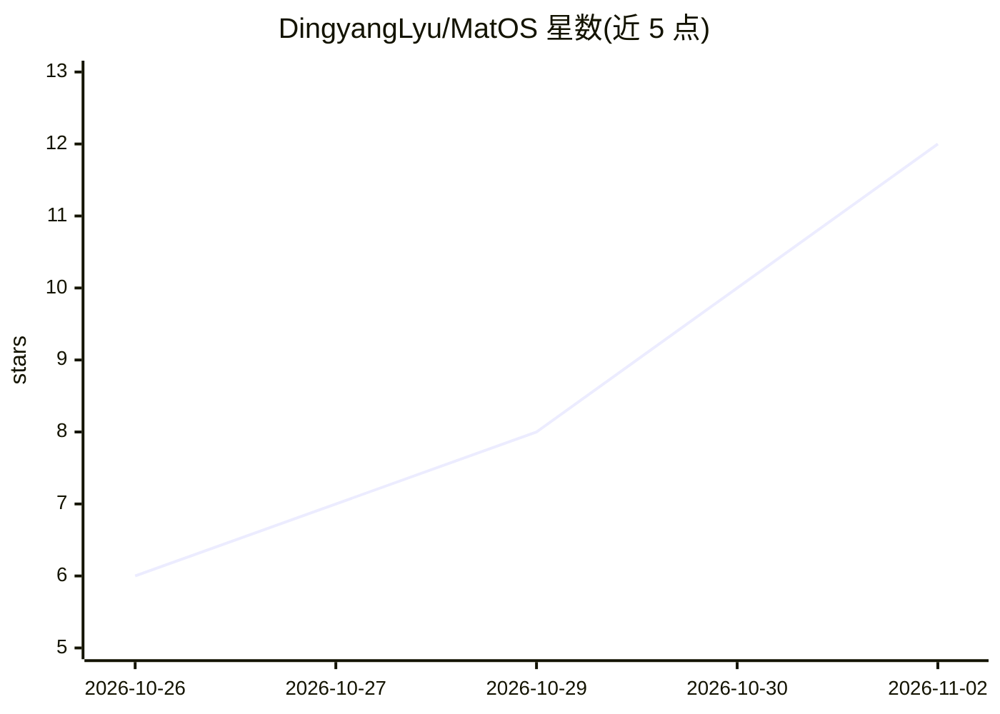

# DingyangLyu/MatOS

⭐ 12 · TypeScript · NOASSERTION · 推送 2026-10-25 · [GitHub](https://github.com/DingyangLyu/MatOS) · [官网](https://github.com/bjzgcai) · 组织维护 · 中文 README

**材料研究的 agent 操作系统：版本化科研资产+有状态工作流**

面向材料研究的 agent 操作系统：以六类版本化科研资产（数据/知识/工具/技能/角色/工作流）构成分层资产图，通过九种节点类型的有状态自适应工作流执行跨文献、计算与实验的长周期任务；执行轨迹与用户反馈经证据驱动的资产演化机制转回资产修订（含结构检查与语义评审，审批可关闭/手动/自动）。引擎基于 DeepSeek Harness，默认 DeepSeek-V4-Flash，可通过网关替换兼容模型。提供浏览器工作台与一键部署脚本；本仓库为开源单用户版，科学 Python 环境与 MLIP 模型需另行安装配置。

## 筛选速览

| 维度 | 判定 | 备注 |
|---|---|---|
| AI 角色 | `ai-ecosystem` | LLM/agent 周边工具 |
| 许可风险 | `none` | NOASSERTION |
| 部署形态 | `None` |  |
| 模型依赖 | locked-api |  |
| 硬件要求 | — | 无带数字的原话,不猜 |
| 安装摩擦 | `low` | 无编译、无系统依赖或容器化 |
| 成熟度 | — | 结构信号不足 |

## 能力要点

- 六类资产×四语义层×六种类型化关系的分层科研资产图
- 九种节点类型的有状态工作流（DAG/状态机、MAP/LOOP、快照与事件台账）
- 证据驱动资产演化：评审-定位-编辑-双通道验收-采纳
- 在 ResearchClawBench/MatTools/SciAgentGym 上给出基准测试结果

## 适用场景

- 让 agent 端到端执行跨文献、计算与实验的材料研究长任务
- 把执行经验沉淀为可复用、可审查的科研资产
- 在基准套件上运行并复现材料 agent 评测

## 场景标签

`科研工具` `Agent 框架` · 领域:Agent 开发

## 证据(README 行号)

> L17: MatOS is an **agent operating system for materials research**. Materials studies run for days, cross literature, co
> L26: - **Stateful adaptive workflows** — nine node types, DAG and state-machine execution, MAP and LOOP, retries, pauses
> L30: - **DeepSeek Harness engine** — DeepSeek Harness (MIT) runs the agent loop and native tools. DeepSeek-V4-Flash is t

## 星数曲线

2026-10-26 6 → 2026-11-02 12（+6）

---
*卡片 v1 · prompt 1.4 · 生成 2026-11-02 · 置信度 high · 依据 README sha `8a973af2d555` · [字段定义](../../DATASET.md)*
