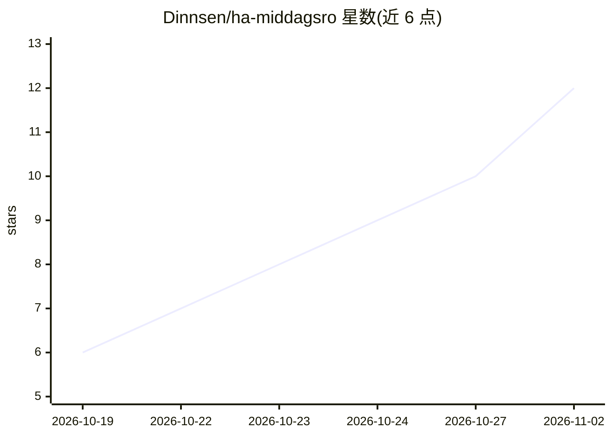

# Dinnsen/ha-middagsro

⭐ 12 · Python · MIT · 推送 2026-11-01 · [GitHub](https://github.com/Dinnsen/ha-middagsro) · 个人维护

**丹麦用户基于 REMA 1000 优惠用 AI 排晚餐计划与购物清单**

非官方 Home Assistant 集成（HACS 分发，需 HA 2026.1+）：调用用户在 HA 中配置的 AI 代理（AI Task，如 Gemini/OpenAI/Anthropic）按 REMA 1000 每周优惠生成 1–14 天晚餐计划，计划事后按预算、过敏、素食次数等规则校验，不合格退回 AI 重试至多两次。为每种配料找最便宜的 REMA 商品，一键同步到 REMA 1000 App 购物清单；另含食谱收藏、厨房计时器、食品预算记账与多连锁比价关注列表。界面为丹麦语，依赖 REMA 网站的私有接口，站点改版可能失效。

## 筛选速览

| 维度 | 判定 | 备注 |
|---|---|---|
| AI 角色 | `ai-enhanced` | 去掉 AI 部分产品仍成立 |
| 许可风险 | `permissive` | MIT |
| 部署形态 | `None` |  |
| 模型依赖 | — | README 未给出锁定关系 |
| 硬件要求 | — | 无带数字的原话,不猜 |
| 安装摩擦 | `low` | 无编译、无系统依赖或容器化 |
| 成熟度 | — | 结构信号不足 |

## 能力要点

- AI 按 REMA 周优惠生成晚餐计划，并按规则事后校验、退回重试至多两次
- 为每种配料匹配最便宜的合规 REMA 商品，一键同步到 REMA 1000 App 清单
- 月度食品预算记账：余额分摊到天、12 周走势与消费预测传感器
- 跨连锁商品降价关注列表，每 3 小时检查并通知

## 适用场景

- 按本周超市优惠自动排全家晚餐并控制食品预算
- 把购物清单直接同步到 REMA 1000 App
- 关注特定商品降价并收到通知

## 场景标签

 · 领域:智能家居/生活自动化

## 证据(README 行号)

> L16: **Middagsro** (Danish for *dinner calm*) plans the week's dinners with AI from REMA 1000's weekly offers (*tilbudsa
> L31: - The AI you have set up in Home Assistant (an **AI Task**, e.g. Google Gemini, OpenAI or Anthropic) plans dinner f

## 星数曲线

2026-10-19 6 → 2026-11-02 12（+6）

---
*卡片 v1 · prompt 1.4 · 生成 2026-11-02 · 置信度 high · 依据 README sha `e554d15614bf` · [字段定义](../../DATASET.md)*
